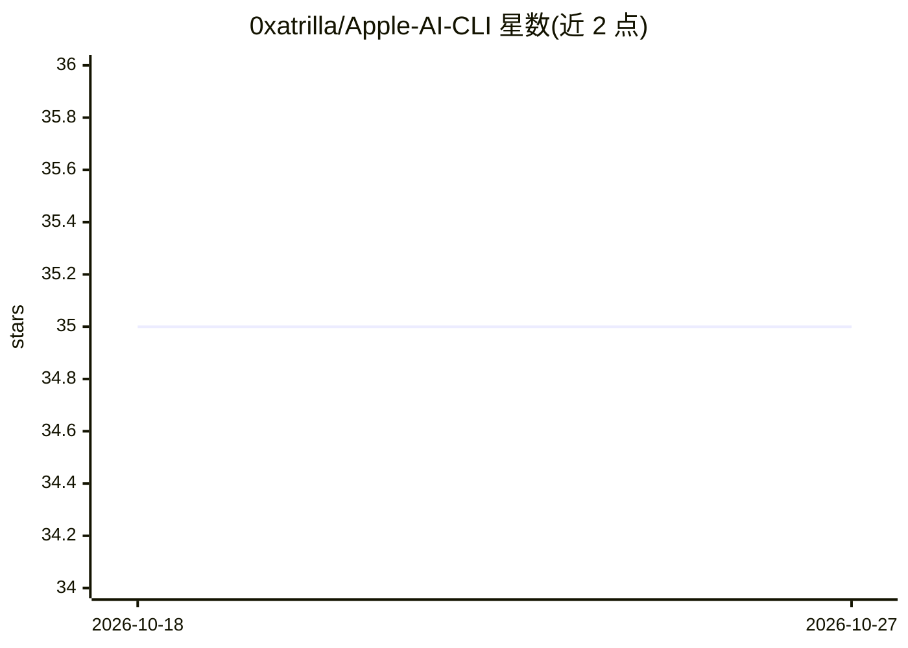

# 0xatrilla/Apple-AI-CLI

⭐ 35 · TypeScript · MIT · 推送 2025-12-16 · [GitHub](https://github.com/0xatrilla/Apple-AI-CLI) · 个人维护

**基于 Apple 设备端模型的代码生成 CLI 工具**

TypeScript 编写的 macOS 命令行代码助手，调用 Apple Intelligence 的 Foundation Models 在设备端生成代码，支持 25+ 编程语言、交互式与直接两种模式、流式输出、会话与对话历史管理、文件保存与剪贴板操作、语法高亮。所有 AI 处理在本地完成，无需 API key。限制：要求 macOS 15+ 且支持 Apple Intelligence，推荐 Apple Silicon。通过 git clone 源码方式构建运行，目标用户为开发者。

## 筛选速览

| 维度 | 判定 | 备注 |
|---|---|---|
| AI 角色 | `ai-native` | 本体是模型或模型工具 |
| 许可风险 | `permissive` | MIT |
| 部署形态 | `None` |  |
| 模型依赖 | — | README 未给出锁定关系 |
| 硬件要求 | — | 无带数字的原话,不猜 |
| 安装摩擦 | `low` | 无编译、无系统依赖或容器化 |
| 成熟度 | — | 结构信号不足 |

## 能力要点

- 调用 Apple Foundation Models 的设备端代码生成
- 交互式 UI 与直接命令行模式，支持流式输出
- 25+ 编程语言、会话管理与对话历史持久化
- 本地处理，无需 API key，代码与提示不外传

## 适用场景

- 在 macOS 终端中生成指定语言的代码片段
- 通过交互式会话迭代式生成和保存代码
- 本地隐私优先的代码生成场景

## 场景标签

`代码生成` · 领域:编码与开发

## 证据(README 行号)

> L10: **A TypeScript CLI tool for code generation using Apple's Foundation Models**
> L18: - **🍎 Apple Intelligence Integration** - Leverages on-device Apple AI models

## 星数曲线

2026-10-18 35 → 2026-10-27 35（+0）

---
*卡片 v1 · prompt 1.4 · 生成 2026-10-25 · 置信度 high · 依据 README sha `6adcadaebc2c` · [字段定义](../../DATASET.md)*
