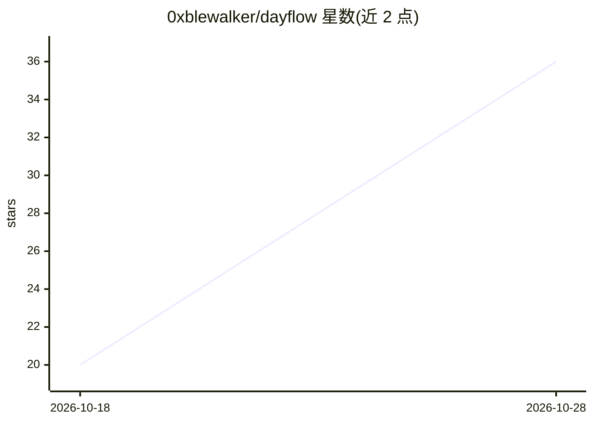

# 0xblewalker/dayflow

⭐ 45 · JavaScript · AGPL-3.0 · 推送 2026-08-16 · [GitHub](https://github.com/0xblewalker/dayflow) · 个人维护 · 中文 README

**面向日常陪伴聊天的缓存感知上下文压缩与遗忘层库**

面向高频 AI 陪伴聊天场景的上下文管理层 npm 库：完整对话保留在档案中，向模型投射一个可替换的时间状态胶囊加有界逐字尾部，按事件生命周期（保留近期原话、今日活跃事件结构化、完结事项退出）压缩工作集。提供 balanced/focused/frugal 等绝对尺寸预设、三时钟时间条目（sourceAt/eventAt/expiresAt）、图像衰减、临时槽位与自校准调参，并导出 Anthropic/OpenAI/OpenRouter 请求形状适配器。不声称压缩无损，明确非目标包括小说写作、长文档与全仓库分析。核心无运行时依赖，需 Node.js 20+，AGPL-3.0-only。

## 筛选速览

| 维度 | 判定 | 备注 |
|---|---|---|
| AI 角色 | `ai-ecosystem` | LLM/agent 周边工具 |
| 许可风险 | `viral` | AGPL-3.0 |
| 部署形态 | `library` | 以包/库形式分发 |
| 模型依赖 | — | README 未给出锁定关系 |
| 硬件要求 | — | 无带数字的原话,不猜 |
| 安装摩擦 | `low` | 无编译、无系统依赖或容器化 |
| 成熟度 | — | 结构信号不足 |

## 能力要点

- 完整档案 + 有界投射：状态胶囊与逐字尾部组合的工作集管理
- 三时钟条目（sourceAt/eventAt/expiresAt），拒绝相对时间入胶囊
- decayImages 图像衰减为投递回执，避免像素反复重发
- autoTune 自校准探测并生成经验证的 custom profile

## 适用场景

- 日常陪伴聊天应用压缩上下文、控制缓存前缀开销
- 让定时器/倒计时类对话基于用户确认的计数器计算而非叙述
- 在压缩后保留同日结构化证据（如饮食时间线）而不升格为长期记忆

## 场景标签

`Agent 记忆` · 领域:Agent 开发

## 证据(README 行号)

> L9: Dayflow keeps the complete conversation in your archive while projecting a small, high-signal working set to the mod
> L63: `messages` should be the complete archived conversation. Dayflow never deletes it. `result.messages` is the bounded
> L235: Small request-shape helpers are exported from `dayflow-context/adapters` for Anthropic, OpenAI, and OpenRouter. Da

## 星数曲线

2026-10-18 20 → 2026-10-28 36（+16）

---
*卡片 v1 · prompt 1.4 · 生成 2026-10-28 · 置信度 high · 依据 README sha `b9482c750ba1` · [字段定义](../../DATASET.md)*
