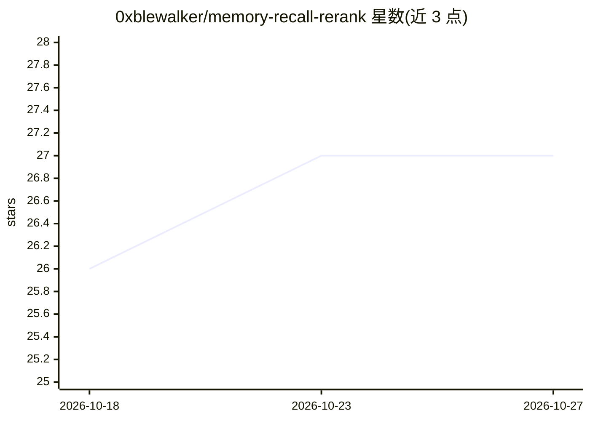

# 0xblewalker/memory-recall-rerank

⭐ 27 · Python · AGPL-3.0 · 推送 2026-08-17 · [GitHub](https://github.com/0xblewalker/memory-recall-rerank) · 个人维护 · 中文 README

**长期记忆检索的重排序参考流水线与可复现基准**

面向长期记忆召回场景的参考流水线与内部基准：确定性门控判定是否检索，近期上下文做指代消解，向量检索广撒网后由重排序器（Cohere Rerank 4 Pro 等）判定查询-候选相关性，仅歧义指代与版本冲突交给 LLM 处理。内置 18 条合成中文记忆召回用例，公开脱敏数据集可重跑；结果为项目内部记录（2026-08-17），阈值不可跨服务商迁移，作者明确要求采用前在自有数据上重新校准。pip 安装，无 API key 可运行确定性测试。AGPL-3.0-only。

## 筛选速览

| 维度 | 判定 | 备注 |
|---|---|---|
| AI 角色 | `ai-ecosystem` | LLM/agent 周边工具 |
| 许可风险 | `viral` | AGPL-3.0 |
| 部署形态 | `library` | 以包/库形式分发 |
| 模型依赖 | locked-api |  |
| 硬件要求 | — | 无带数字的原话,不猜 |
| 安装摩擦 | `low` | 无编译、无系统依赖或容器化 |
| 成熟度 | — | 结构信号不足 |

## 能力要点

- 确定性门控 + 指代消解 + 广检索 + 重排序的分层流水线
- 18 条合成中文记忆召回用例的内部基准与公开脱敏数据集
- 歧义回调仅返回候选 ID，不重写记忆文本
- 重排序失败时返回类型化失败，双失败时 fail closed

## 适用场景

- 为带长期记忆的对话系统搭建可审计的召回流水线
- 评估不同重排序器（Cohere/Voyage/LLM）在记忆召回任务上的表现
- 校准自己模型与数据集上的重排序阈值

## 场景标签

`Agent 记忆` `RAG` `模型评测` · 领域:Agent 开发

## 证据(README 行号)

> L3: A reproducible benchmark and reference pipeline for long-term memory retrieval.
> L14: Vector search retrieves broadly. A reranker judges query–candidate relevance. Deterministic rules protect temporal 
> L51: A reranker answers “which candidate is most relevant?” It does not decide whether long-term memory should be search

## 星数曲线

2026-10-18 26 → 2026-10-27 27（+1）

---
*卡片 v1 · prompt 1.4 · 生成 2026-10-26 · 置信度 high · 依据 README sha `1759859d09b6` · [字段定义](../../DATASET.md)*
