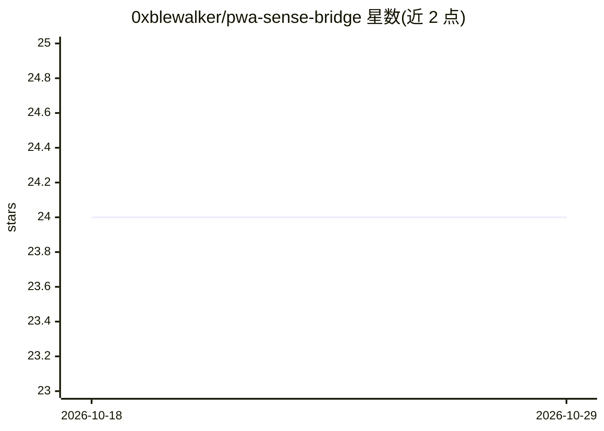

# 0xblewalker/pwa-sense-bridge

⭐ 24 · JavaScript · AGPL-3.0 · 推送 2026-08-16 · [GitHub](https://github.com/0xblewalker/pwa-sense-bridge) · 个人维护 · 中文 README

**PWA 传感器事件桥：把吹气/转动/摇晃转为结构化事件交给 LLM**

无依赖的浏览器端库，将移动端 PWA 中的吹气（麦克风本机分析）、转动（重力向量）、摇晃与长按等输入转换为结构化 sensor_event 语义事件，供宿主应用注入任意 LLM 对话后端。不绑定 Anthropic、OpenAI、MCP 或特定聊天框架；是否发送、如何注入由宿主决定。提供能力检测、诊断报告、本地测试模式与单项禁用 API；生产需 HTTPS，目标为 iOS Safari/PWA 与 Android Chromium，不承诺所有厂商 WebView 行为一致。

## 筛选速览

| 维度 | 判定 | 备注 |
|---|---|---|
| AI 角色 | `ai-ecosystem` | LLM/agent 周边工具 |
| 许可风险 | `viral` | AGPL-3.0 |
| 部署形态 | `None` |  |
| 模型依赖 | — | README 未给出锁定关系 |
| 硬件要求 | — | 无带数字的原话,不猜 |
| 安装摩擦 | `low` | 无编译、无系统依赖或容器化 |
| 成熟度 | — | 结构信号不足 |

## 能力要点

- 吹气/转动/摇晃/长按转结构化语义事件，带阈值、冷却与强度归一化
- 不绑定特定 LLM 提供商或聊天框架，注入方式由宿主应用决定
- 能力检测与诊断报告，用于定位 Android 浏览器碎片化问题
- 麦克风音量只在本机分析，不上传录音

## 适用场景

- 让 LLM 驱动的 PWA 感知用户吹气、摇晃、转动等物理输入
- 通过诊断报告排查不同浏览器传感器兼容性问题
- 本地测试模式下验证事件流而不触发真实发送

## 场景标签

 · 领域:Web/移动端传感器与 LLM 集成

## 证据(README 行号)

> L3: 一个无依赖、隐私优先的移动端感知桥。它把 PWA 中的吹气、转动、摇晃和长按转换为结构化事件，交给任意 LLM 对话后端。
> L12: 它不绑定 Anthropic、OpenAI、MCP 或特定聊天框架。项目只负责把现实输入整理成稳定事件；是否发送、如何注入上下文，由宿主应用决定。
> L42: ## 交给模型的方式

## 星数曲线

2026-10-18 24 → 2026-10-29 24（+0）

---
*卡片 v1 · prompt 1.4 · 生成 2026-10-27 · 置信度 high · 依据 README sha `9e8f736b78f0` · [字段定义](../../DATASET.md)*
