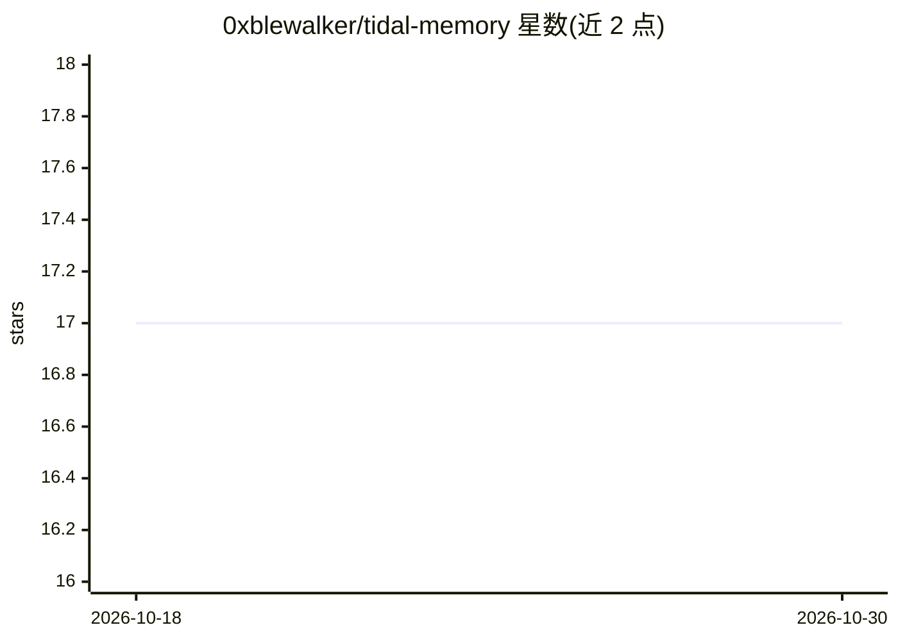

# 0xblewalker/tidal-memory

⭐ 17 · Python · AGPL-3.0 · 推送 2026-08-16 · [GitHub](https://github.com/0xblewalker/tidal-memory) · 个人维护 · 中文 README

**对话 agent 的分层长期记忆引擎：双分辨率记忆与三阀召回**

面向对话 agent 的 Python 记忆库与 CLI：将近期对话压缩为低分辨率印象（窗口→每周→每月滚动归档），语义事实与高重要度记忆走独立注入路径；详情仅在召回策略允许时经检索器+可选校验器返回。召回由触发灵敏度、关联半径、注入预算三个独立参数控制。默认用 SQLite FTS5 加多语言词法重叠检索，零依赖运行，向量检索器可经单一接口接入；印象写入、事实抽取、持续线程均可传入自定义 LLM 回调，也可完全无 LLM 运行。提供自然语言原语（remember/forget/supersede）供 agent 映射用户指令。

## 筛选速览

| 维度 | 判定 | 备注 |
|---|---|---|
| AI 角色 | `ai-ecosystem` | LLM/agent 周边工具 |
| 许可风险 | `viral` | AGPL-3.0 |
| 部署形态 | `library` | 以包/库形式分发 |
| 模型依赖 | — | README 未给出锁定关系 |
| 硬件要求 | — | 无带数字的原话,不猜 |
| 安装摩擦 | `low` | 无编译、无系统依赖或容器化 |
| 成熟度 | `idea` | |

## 能力要点

- 低分辨率印象与高分辨率详情分离的注入路径
- SQLite FTS5 + 多语言词法重叠零依赖可用，向量检索可选接入
- 三阀召回策略（trigger/association/injection budget）独立控制
- 渐进遗忘：窗口印象归档为周/月印象，源数据不销毁
- 时间感知事实：occurrence 与 recording time 分离，可被取代但保留历史

## 适用场景

- 为长期陪伴型聊天 agent 提供分层记忆与受控召回
- 让主对话模型在对话现场主动保存关键时刻
- 跨时区、跨窗口维护持续事项（ongoing threads）的活跃状态

## 场景标签

`Agent 记忆` · 领域:Agent 开发

## 证据(README 行号)

> L3: A quiet, layered memory engine for conversational agents.
> L28: - **No UI:** applications integrate the library or CLI. Debugging remains an
> L119: Combine it with the zero-dependency backend:

## 星数曲线

2026-10-18 17 → 2026-10-30 17（+0）

---
*卡片 v1 · prompt 1.4 · 生成 2026-10-30 · 置信度 mid · 依据 README sha `bc6a062be570` · [字段定义](../../DATASET.md)*
