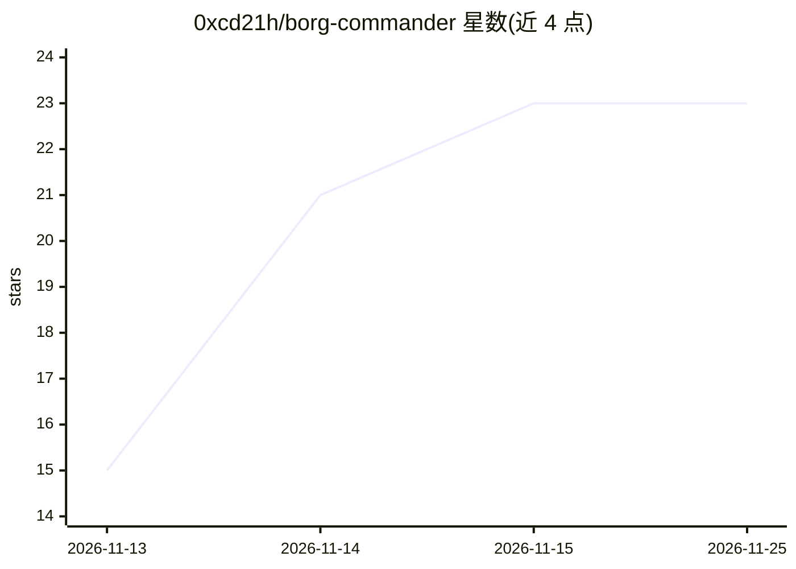

# 0xcd21h/borg-commander

⭐ 23 · Rust · Apache-2.0 · 推送 2026-11-23 · [GitHub](https://github.com/0xcd21h/borg-commander) · [官网](https://0xcd21h.github.io/borg-commander/) · 个人维护

**面向 macOS/Linux 的双栏文件管理器，内嵌 shell 并支持 AI 代理远程接入**

用 Rust 编写的双栏文件管理器，延续 Norton/Midnight Commander 的按键布局（F3 查看、F4 编辑、F5 复制、Ctrl-O 切换内嵌 bash/zsh/fish）。功能包括磁盘占用分析、跨文件搜索替换、可断点续传的后台复制、进程与内存监控、网络监控、启动项审计、Docker 仪表板，以及通过端到端加密中继的无开放端口远程控制。内置 MCP Server，配对后 Claude 可远程操作该机器上的文件与命令，每次变更需用户批准。

## 筛选速览

| 维度 | 判定 | 备注 |
|---|---|---|
| AI 角色 | `ai-enhanced` | 去掉 AI 部分产品仍成立 |
| 许可风险 | `permissive` | Apache-2.0 |
| 部署形态 | `None` |  |
| 模型依赖 | locked-api |  |
| 硬件要求 | — | 无带数字的原话,不猜 |
| 安装摩擦 | `low` | 无编译、无系统依赖或容器化 |
| 成熟度 | — | 结构信号不足 |

## 能力要点

- 双栏文件管理 + 内嵌 bash/zsh/fish，Ctrl-O 切换
- MCP Server：配对后 Claude 可经加密中继远程操作任意配对机器，变更需逐次批准
- 无开放端口的远程控制：端到端加密中继，密钥不出本机
- 进程/内存/网络监控、启动项审计、Docker 仪表板、磁盘占用分析

## 适用场景

- 在终端里用熟悉的 Commander 按键管理文件并随时切回 shell
- 让 Claude 在远程服务器或容器里协助工作并逐项审批变更
- 从笔记本驱动无公网地址、防火墙后的服务器

## 场景标签

 · 领域:终端工具/系统管理

## 证据(README 行号)

> L69: - **MCP Server for Claude.** Pair once, and Claude on your computer works on any of your machines through Borg, whi
> L13:  A two-panel file manager with your shell built in.

## 星数曲线

2026-11-13 15 → 2026-11-25 23（+8）

---
*卡片 v1 · prompt 1.4 · 生成 2026-11-18 · 置信度 high · 依据 README sha `6f96817d66a0` · [字段定义](../../DATASET.md)*
