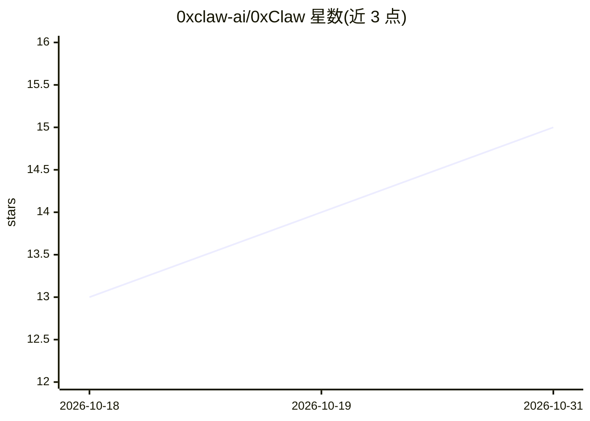

# 0xclaw-ai/0xClaw

⭐ 15 · Python · MIT · 推送 2026-10-19 · [GitHub](https://github.com/0xclaw-ai/0xClaw) · [官网](https://0xclaw-ai.github.io) · 组织维护 · 中文 README

**自主黑客松参赛 agent：从调研到编码、测试、提交全自动运行**

给 0xClaw 一个黑客松页面 URL，它在本机自主执行研究、方案生成、架构规划、编码、测试、文档到提交的多阶段流水线。默认通过 Z.ai API（glm-5.1）推理，可切换 FLock.io、Claude Code 后端；论文配套的 BudgetRouter 与 DeadlineFramer 为独立仓库的可选组件（本地 Qwen3.5-2B LoRA 推理、阶段预算与截止时间调节）。以 Python 包安装，提供交互式 CLI、会话管理与 Telegram/Discord/飞书/钉钉等多消息通道适配。

## 筛选速览

| 维度 | 判定 | 备注 |
|---|---|---|
| AI 角色 | `ai-native` | 本体是模型或模型工具 |
| 许可风险 | `permissive` | MIT |
| 部署形态 | `library` | 以包/库形式分发 |
| 模型依赖 | — | README 未给出锁定关系 |
| 硬件要求 | — | 无带数字的原话,不猜 |
| 安装摩擦 | `low` | 无编译、无系统依赖或容器化 |
| 成熟度 | — | 结构信号不足 |

## 能力要点

- 研究→编码→测试→提交的多阶段自主流水线（CLI 交互与 /resume 会话恢复）
- 可选 BudgetRouter/DeadlineFramer 组件：本地模型阶段预算与截止时间控制
- 10 种消息通道适配（Telegram/Discord/Slack/飞书/钉钉/QQ/WhatsApp 等）
- EMNLP 2026 论文配套项目，附 Hugging Face 模型与数据集

## 适用场景

- 把黑客松 URL 交给 agent 自主完成调研到提交的全流程
- 按阶段调试或重跑（/redo）agent 的开发流水线
- 通过 Telegram/WhatsApp 等消息渠道远程驱动 agent

## 场景标签

`编码 Agent` · 领域:编码与开发

## 证据(README 行号)

> L3: **Autonomous hackathon agent** — give it a hackathon URL; it runs research through submission on your machine.
> L141: ```text

## 星数曲线



2026-10-18 13 → 2026-10-31 15（+2）


---
*卡片 v1 · prompt 1.4 · 生成 2026-10-31 · 置信度 mid · 依据 README sha `e814d093ae30` · [字段定义](../../DATASET.md)*
