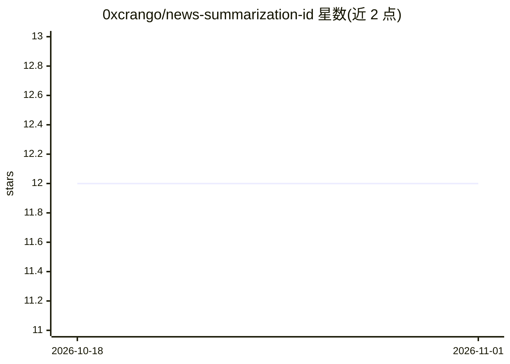

# 0xcrango/news-summarization-id

⭐ 12 · Python · MIT · 推送 2026-06-03 · [GitHub](https://github.com/0xcrango/news-summarization-id) · 个人维护

**印尼语新闻摘要项目：微调 IndoBART/mT5 生成标题与段落摘要**

面向 NLP 开发者与科研的印尼语新闻摘要训练工程：在 IndoNLG/Liputan6/IndoSum 数据集上微调 IndoBART-v2 或 mT5-small，支持 headline 与 2-3 句段落摘要两种模式，评估输出 ROUGE-1/2/L。以 Python 脚本集合形式提供（prepare_data/train/eval/infer），通过 pip 安装 requirements.txt 依赖（transformers、datasets、evaluate、sentencepiece）。README 记录在 AMD MI210（fp16）上完成微调的显存估算，ROCm 6.x + PyTorch wheel 即可运行、无 CUDA-only 算子。MIT 许可。

## 筛选速览

| 维度 | 判定 | 备注 |
|---|---|---|
| AI 角色 | `ai-native` | 本体是模型或模型工具 |
| 许可风险 | `permissive` | MIT |
| 部署形态 | `library` | 以包/库形式分发 |
| 模型依赖 | — | README 未给出锁定关系 |
| 硬件要求 | — | 无带数字的原话,不猜 |
| 安装摩擦 | `medium` | 含编译或系统依赖之一 |
| 成熟度 | — | 结构信号不足 |

## 能力要点

- 微调 IndoBART-v2 / mt5-small，生成标题与 2-3 句段落摘要
- 支持 IndoNLG / Liputan6 / IndoSum 三种数据源准备脚本
- 评估输出 ROUGE-1 / ROUGE-2 / ROUGE-L
- 文档记录单卡 MI210 fp16 微调与 ROCm 6.x 依赖路径

## 适用场景

- 训练印尼语新闻标题与摘要生成模型
- 在 AMD GPU（ROCm）环境下微调序列到序列模型
- 用 ROUGE 指标对比不同摘要模型效果

## 场景标签

`微调` · 领域:训练与推理

## 证据(README 行号)

> L3: Indonesian news summarization: headline + 2-3 sentence paragraph summary.
> L25: python train.py \

## 星数曲线

2026-10-18 12 → 2026-11-01 12（+0）

---
*卡片 v1 · prompt 1.4 · 生成 2026-11-01 · 置信度 high · 依据 README sha `f846e71f21e5` · [字段定义](../../DATASET.md)*
