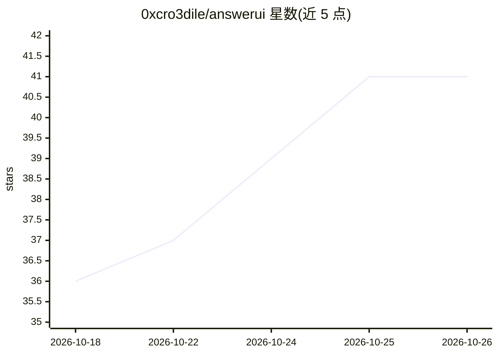

# 0xcro3dile/answerui

⭐ 41 · TypeScript · MIT · 推送 2026-10-21 · [GitHub](https://github.com/0xcro3dile/answerui) · 个人维护

**开源生成式 UI 聊天前端：以图表/3D 场景等界面回答提问**

自托管的开源聊天应用，定位为 ChatGPT Intelligent UI 的替代方案：模型以 OpenUI Lang 流式输出界面，每个场景作为沙箱代码岛运行并与回答状态双向绑定，回答形式包括图表、表单、计算器及可交互的 2D/3D 场景。兼容任意 OpenAI 兼容模型（OpenAI、OpenRouter、Kimi、Groq、LM Studio），支持本地 Ollama 运行。提供 npx、Docker 与源码三种运行方式；无遥测，模型生成的场景运行在锁定沙箱中，不能访问应用或 API key。

## 筛选速览

| 维度 | 判定 | 备注 |
|---|---|---|
| AI 角色 | `ai-native` | 本体是模型或模型工具 |
| 许可风险 | `permissive` | MIT |
| 部署形态 | `self-host` | docker 或自建部署 |
| 模型依赖 | local-ok | 支持本地模型 |
| 硬件要求 | — | 无带数字的原话,不猜 |
| 安装摩擦 | `low` | 无编译、无系统依赖或容器化 |
| 成熟度 | — | 结构信号不足 |

## 能力要点

- 回答以图表、表单、计算器与可交互 2D/3D 场景呈现
- 兼容任意 OpenAI 兼容接口，支持云端或本地 Ollama
- 模型场景运行于锁定沙箱，无法访问应用与 API key
- 无遥测，API key 留在本地

## 适用场景

- 向模型提问并获得可交互的 3D/2D 演示或计算器界面
- 在本地用 Ollama 运行生成式 UI 问答界面
- 自托管一个不外发数据、key 留在本地的聊天前端

## 场景标签

`聊天机器人` · 领域:对话与助手

## 证据(README 行号)

> L14: AnswerUI is an open-source alternative to ChatGPT's Intelligent UI. It answers with interfaces instead of
> L16: instantly, and the numbers it works out flow back into the text. It works with any OpenAI-compatible model,
> L19: **How it works:** the model streams the interface in OpenUI Lang, and each scene runs as a sandboxed code

## 星数曲线

2026-10-18 36 → 2026-10-26 41（+5）

---
*卡片 v1 · prompt 1.4 · 生成 2026-10-25 · 置信度 high · 依据 README sha `ce369450cb40` · [字段定义](../../DATASET.md)*
