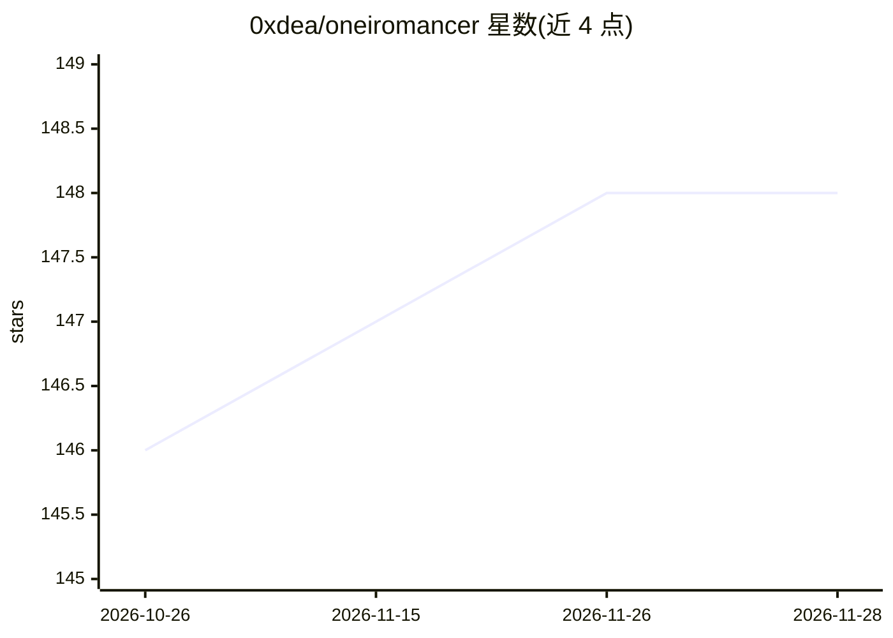

# 0xdea/oneiromancer

⭐ 148 · Rust · MIT · 推送 2026-11-27 · [GitHub](https://github.com/0xdea/oneiromancer) · [官网](https://ollama.com) · 个人维护

**逆向工程助手：用本地微调 LLM 分析 Hex-Rays 伪代码**

用 Rust 编写的命令行逆向工程辅助工具，调用本地运行的微调模型 aidapal（基于 mistral-7b-instruct）分析函数或代码片段，输出代码功能描述、推荐函数名与变量重命名建议，并将改进后的伪代码保存为独立文件。通过 Ollama 运行模型权重，可经 crates.io 安装为可执行文件或 Rust 库，外部 crate 可调用 analyze_code/analyze_file 接口。建议逐函数提交以获得较好结果。

## 筛选速览

| 维度 | 判定 | 备注 |
|---|---|---|
| AI 角色 | `ai-native` | 本体是模型或模型工具 |
| 许可风险 | `permissive` | MIT |
| 部署形态 | `library` | 以包/库形式分发 |
| 模型依赖 | local-ok | 支持本地模型 |
| 硬件要求 | — | 无带数字的原话,不猜 |
| 安装摩擦 | `medium` | 含编译或系统依赖之一 |
| 成熟度 | — | 结构信号不足 |

## 能力要点

- 基于 mistral-7b-instruct 微调的 aidapal 模型，本地运行
- 输出代码描述、函数命名建议与变量重命名建议
- 提供 analyze_code/analyze_file 的 Rust 库接口
- 与伪代码提取器 haruspex 及常用 IDE 集成

## 适用场景

- 逆向分析反编译出的 C 伪代码时获取功能说明
- 为分析中的函数批量生成命名与变量重命名建议
- 在 Rust 工程中嵌入伪代码分析流程

## 场景标签

 · 领域:安全/逆向工程工具

## 证据(README 行号)

> L11: Oneiromancer is a reverse engineering assistant that uses a locally running LLM that has been fine-tuned for Hex-Ra
> L14: results of the analysis.
> L62: 1. Download and install Ollama.

## 星数曲线

2026-10-26 146 → 2026-11-28 148（+2）

---
*卡片 v1 · prompt 1.4 · 生成 2026-11-27 · 置信度 high · 依据 README sha `9df4dd51a604` · [字段定义](../../DATASET.md)*
