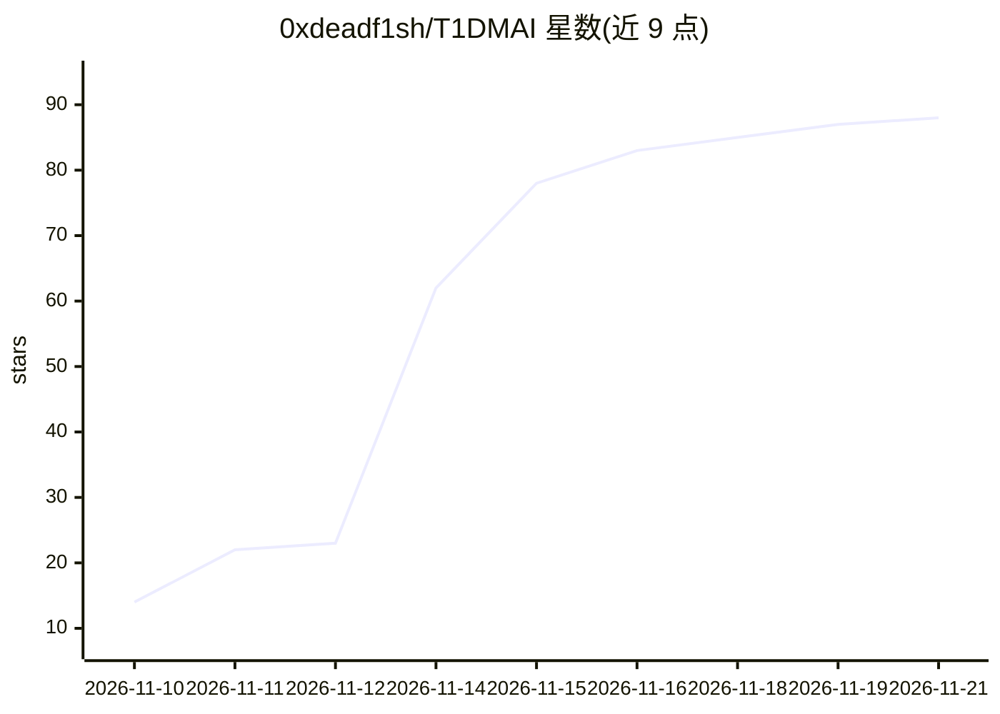

# 0xdeadf1sh/T1DMAI

⭐ 88 · Python · MIT · 推送 2026-11-15 · [GitHub](https://github.com/0xdeadf1sh/T1DMAI) · 个人维护

**1 型糖尿病血糖预测模型库：自训模型与 30 余模型对比评测**

个人维护的血糖预测模型库（model zoo）：作者自研 31k 参数的 encoder-only transformer（T1DMAI D16，DILATE/MSE 两种损失），预测未来 2 小时逐 5 分钟的血糖分位数，在合成数据上训练后可用 3771 参数的 LoRA 适配器微调；同时在其个人数据（115 天）与公开 MetaboNet 数据上训练并评测基线、经典方法、深度模型与基础模型（XGBoost、PatchTST、Chronos、TimesFM、Timestral 等）30 余个，按 RMSE、Wilcoxon 检验、误差网格与低血糖捕捉率对比。模型可通过 ExecuTorch/LiteRT 在手机上运行。README 明确声明仅供研究与教育用途，非医疗器械、无临床验证与监管审批。

## 筛选速览

| 维度 | 判定 | 备注 |
|---|---|---|
| AI 角色 | `ai-native` | 本体是模型或模型工具 |
| 许可风险 | `permissive` | MIT |
| 部署形态 | `None` |  |
| 模型依赖 | — | README 未给出锁定关系 |
| 硬件要求 | — | 无带数字的原话,不猜 |
| 安装摩擦 | `low` | 无编译、无系统依赖或容器化 |
| 成熟度 | — | 结构信号不足 |

## 能力要点

- 自研 31k 参数 transformer 输出未来 2 小时 7 档分位数预测（5%-95%）
- 在个人数据与 MetaboNet 上系统对比 30 余种基线/经典/深度/基础模型
- 合成数据预训练 + 3771 参数 rank-1 LoRA 轻量微调
- 支持 ExecuTorch / LiteRT 在手机端运行（配套 T1DMDROID）

## 适用场景

- 了解各血糖预测方法在统一评测协议下的表现
- 复用作者的个人数据训练/评测流程做血糖预测研究
- 在手机端以小模型做血糖分位数预测实验

## 场景标签

`模型评测` · 领域:评测与运维

## 证据(README 行号)

> L6: This repo is a zoo. Here I train & test many blood glucose forecasting models (including my own)
> L9: My model is a small transformer that forecasts blood glucose 2 hours ahead. I've made two variants: D16 DILATE and D

## 星数曲线

2026-11-10 14 → 2026-11-21 88（+74）

---
*卡片 v1 · prompt 1.4 · 生成 2026-11-18 · 置信度 high · 依据 README sha `dce03b2062a5` · [字段定义](../../DATASET.md)*
