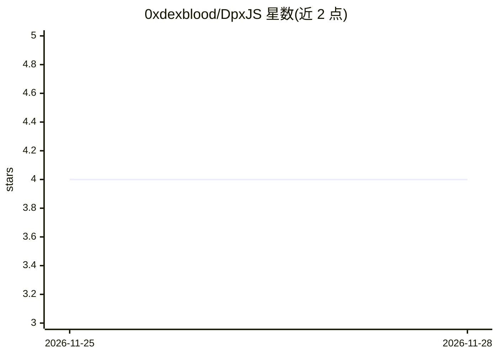

# 0xdexblood/DpxJS

⭐ 4 · MIT · 推送 2026-11-22 · [GitHub](https://github.com/0xdexblood/DpxJS) · 个人维护

**Firefox 浏览器端 JS 安全分析扩展：验证 XSS 流与泄露密钥**

DPXJS 是 Firefox 扩展（Manifest V3），收集页面加载的所有脚本，用 Acorn AST 解析并运行污点分析，追踪攻击者可控 source 到危险 sink 的路径，只报告已验证的流以降低噪音。功能覆盖 DOM XSS/开放重定向/原型污染流、postMessage 事件、端点导出（JSON）、密钥检测（AWS/GitHub/Stripe/JWT 等，含验证）与漏洞库版本识别。全部本地运行，仅点击 AI 按钮时经 Numes 做一键 AI 分诊。需 Firefox 115+，以临时加载项方式安装，重启后移除。

## 筛选速览

| 维度 | 判定 | 备注 |
|---|---|---|
| AI 角色 | `ai-enhanced` | 去掉 AI 部分产品仍成立 |
| 许可风险 | `permissive` | MIT |
| 部署形态 | `None` |  |
| 模型依赖 | — | README 未给出锁定关系 |
| 硬件要求 | — | 无带数字的原话,不猜 |
| 安装摩擦 | `low` | 无编译、无系统依赖或容器化 |
| 成熟度 | — | 结构信号不足 |

## 能力要点

- Acorn AST + source→sink 污点分析，仅报告已验证的 XSS 流
- 密钥检测覆盖 AWS、GitHub、Stripe、Slack、JWT 等并含验证
- 端点收集支持 Full URL/Path 视图、正则过滤与 JSON 导出
- 可选一键 AI 分诊（经 Numes），数据默认不离开本地

## 适用场景

- 审计网页客户端 JS 中的 DOM XSS 风险
- 扫描页面脚本里泄露的 API 密钥与令牌
- 收集隐藏端点并导出 JSON 供后续测试

## 场景标签

`网络安全` · 领域:学习与行业

## 证据(README 行号)

> L22: DPXJS collects every script a page loads, parses it with a real **AST parser (Acorn)** and runs **taint analysis** 
> L35: |🤖|**AI triage**|Optional one-click verdicts via Numes.|
> L40: Firefox **115+**.

## 星数曲线

2026-11-25 4 → 2026-11-28 4（+0）

---
*卡片 v1 · prompt 1.4 · 生成 2026-11-24 · 置信度 high · 依据 README sha `7295ddfe6812` · [字段定义](../../DATASET.md)*
