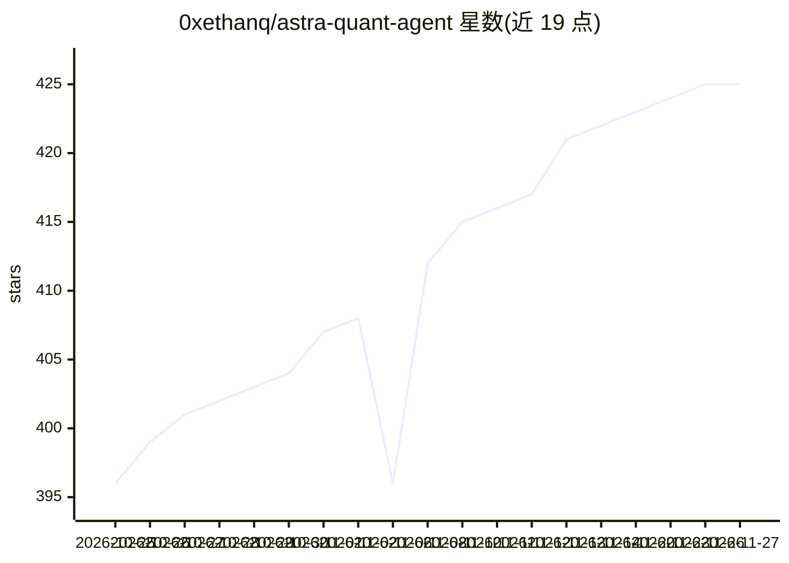

# 0xethanq/astra-quant-agent

⭐ 425 · Python · NOASSERTION · 推送 2026-11-26 · [GitHub](https://github.com/0xethanq/astra-quant-agent) · [官网](https://www.astraquant.tech) · 个人维护 · 中文 README

**加密货币量化交易系统：多 LLM 分析加 Python 风控执行**

AstraQuant 是加密货币自主交易系统：由多模型委员会（Macro/Trend/Microstructure/Contrarian 四席位）分析市场并产出订单意图，确定性 Python 代码对杠杆、仓位与止损拥有否决权，通过 OKX 原生条件单执行。每 15 分钟运行一轮：行情摄取与因子计算（CVD、OBI、资金费率、IV 偏斜等）→ LLM 分析 → 风控闸门 → 交易所执行。默认以 paper trading（demo）模式启动，实盘需验证只读余额快照后才解锁。提供 Vue 3 前端工作台、管理面板与 OpenAPI 文档，Docker Compose 或 Linux/macOS 裸机部署。仅支持 OKX API 交易。

## 筛选速览

| 维度 | 判定 | 备注 |
|---|---|---|
| AI 角色 | `ai-native` | 本体是模型或模型工具 |
| 许可风险 | `none` | NOASSERTION |
| 部署形态 | `self-host` | docker 或自建部署 |
| 模型依赖 | — | README 未给出锁定关系 |
| 硬件要求 | — | 无带数字的原话,不猜 |
| 安装摩擦 | `low` | 无编译、无系统依赖或容器化 |
| 成熟度 | — | 结构信号不足 |

## 能力要点

- 多模型席位分析 + 三种共识仲裁模式（Paranoid Veto / 加权多数 / Alpha Momentum）
- 确定性 Python 风控闸门：仓位上限、回撤熔断、R:R 下限、杠杆钳制
- 每笔订单在交易所侧以原生 OCO 条件单对冲（TP1/TP2/止损）
- Prompt 缓存架构：共享静态前缀降低 LLM API token 成本

## 适用场景

- 7×24 自动运行加密货币合约交易策略
- 用微结构因子（CVD/OBI/资金费率）驱动交易决策
- 在 paper trading 模式下先验证策略再接实盘

## 场景标签

`金融量化` `多智能体` · 领域:Agent 开发

## 证据(README 行号)

> L12: AstraQuant combines large language models (macro, technical, and microstructure analysis) with deterministic Python
> L60: 1. **Hypothesis vs. Enforcement**: LLMs analyze market structure and propose order intents; deterministic Python co
> L70: 2. Multi-Model Council (LLMs)   ──> Macro, Trend, and Microstructure seats analyze & synthesize order intent

## 星数曲线

2026-10-25 396 → 2026-11-27 425（+29）

---
*卡片 v1 · prompt 1.4 · 生成 2026-11-27 · 置信度 mid · 依据 README sha `a47202156871` · [字段定义](../../DATASET.md)*
