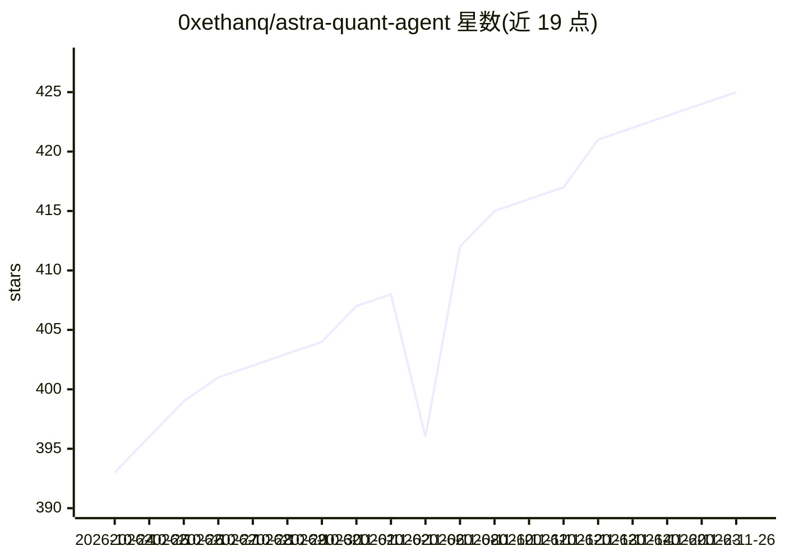

# 0xethanq/astra-quant-agent

⭐ 425 · Python · NOASSERTION · 推送 2026-11-25 · [GitHub](https://github.com/0xethanq/astra-quant-agent) · [官网](https://www.astraquant.tech) · 个人维护 · 中文 README

**面向加密货币交易者的多模型分析+确定性风控自动交易系统**

AstraQuant 是一个自主加密货币交易系统：在 15 分钟交易周期内，由多个 LLM 席位（宏观、趋势、微观结构、逆向）分析市场因子并产生订单意图，再由确定性 Python 代码执行风控闸门（仓位钳制、盈亏比下限、熔断器），最终通过 OKX 原生条件单（OCO 止盈止损）执行。默认以 paper trading 模式启动，实盘执行需提供并校验交易所凭证。提供 Vue 3 工作站前端、管理面板与 OpenAPI 文档，支持 Docker Compose 或裸机部署。

## 筛选速览

| 维度 | 判定 | 备注 |
|---|---|---|
| AI 角色 | `ai-native` | 本体是模型或模型工具 |
| 许可风险 | `none` | NOASSERTION |
| 部署形态 | `self-host` | docker 或自建部署 |
| 模型依赖 | — | README 未给出锁定关系 |
| 硬件要求 | — | 无带数字的原话,不猜 |
| 安装摩擦 | `low` | 无编译、无系统依赖或容器化 |
| 成熟度 | — | 结构信号不足 |

## 能力要点

- 多 LLM 席位共识仲裁（Paranoid Veto / 加权多数 / Alpha Momentum）
- 确定性 Python 风控代码对杠杆、仓位与止损持有绝对否决权
- CVD、OBI、资金费率、IV 偏斜等衍生市场因子持续计算
- 默认 paper trading 模式，实盘执行物理阻断直至凭证校验

## 适用场景

- 7×24 自动执行带交易所侧条件单保护的加密货币交易
- 用多模型委员会替代单一模型做市场分析决策
- 以 paper trading 模式先验证策略再接入实盘

## 场景标签

`多智能体` `金融量化` · 领域:Agent 开发

## 证据(README 行号)

> L12: AstraQuant combines large language models (macro, technical, and microstructure analysis) with deterministic Python
> L59: 1. **Hypothesis vs. Enforcement**: LLMs analyze market structure and propose order intents; deterministic Python co
> L69: 2. Multi-Model Council (LLMs)   ──> Macro, Trend, and Microstructure seats analyze & synthesize order intent

## 星数曲线

2026-10-24 393 → 2026-11-26 425（+32）

---
*卡片 v1 · prompt 1.4 · 生成 2026-11-25 · 置信度 mid · 依据 README sha `8aae918b51cb` · [字段定义](../../DATASET.md)*
