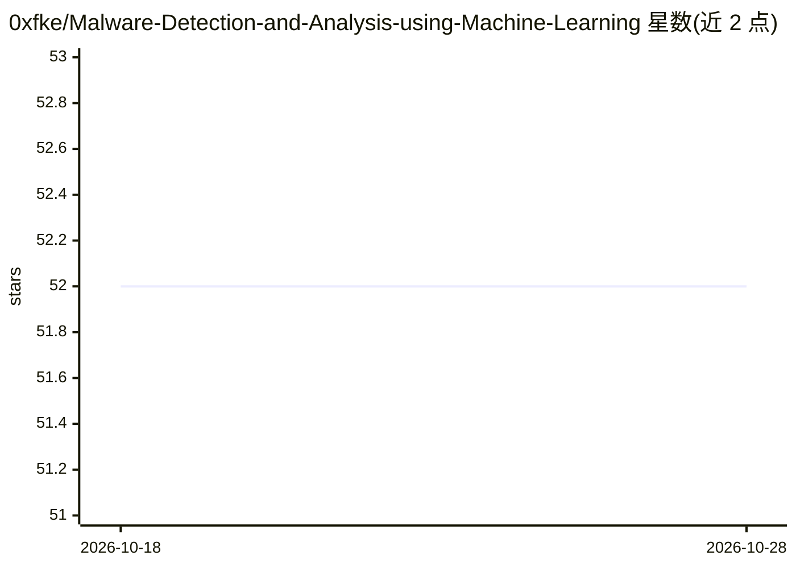

# 0xfke/Malware-Detection-and-Analysis-using-Machine-Learning

⭐ 52 · Jupyter Notebook · MIT · 推送 2026-02-04 · [GitHub](https://github.com/0xfke/Malware-Detection-and-Analysis-using-Machine-Learning) · [官网](https://0xfke.github.io/posts/projectmdaml) · 组织维护

**基于机器学习与 VirusTotal API 的恶意软件检测分析 Web 应用**

Flask Web 应用，提供两条恶意软件检测路径：一是调用 VirusTotal API 对任意文件、URL 和哈希做静态扫描并展示威胁情报；二是对 .exe/.dll 文件提取 PE 头特征，经 Random Forest 特征筛选后训练的模型判定良性/恶意，报告指标约 99% 准确率（在均衡数据集上验证）。面向需要可访问界面的安全分析用户；限制包括 VirusTotal API 速率限制、ML 路径仅支持可执行文件格式。通过 git clone 源码运行，未来计划加入沙箱动态分析。

## 筛选速览

| 维度 | 判定 | 备注 |
|---|---|---|
| AI 角色 | `ai-native` | 本体是模型或模型工具 |
| 许可风险 | `permissive` | MIT |
| 部署形态 | `desktop` | 安装包/桌面程序 |
| 模型依赖 | — | README 未给出锁定关系 |
| 硬件要求 | — | 无带数字的原话,不猜 |
| 安装摩擦 | `low` | 无编译、无系统依赖或容器化 |
| 成熟度 | — | 结构信号不足 |

## 能力要点

- VirusTotal API 静态分析：支持任意文件、URL 与哈希
- PE 头特征提取 + Random Forest 模型判定 .exe/.dll 良恶
- 特征按重要度筛选后训练，报告约 99% 准确率
- Flask Web 界面展示检测结果与概率分数

## 适用场景

- 上传文件或提交 URL 快速获取 VirusTotal 威胁情报
- 对 Windows 可执行文件做基于 ML 的良恶判定
- 毕设/安全学习场景中了解恶意软件检测流程

## 场景标签

`网络安全` · 领域:学习与行业

## 证据(README 行号)

> L72: The **Machine Learning-Based Detection** component leverages a machine learning model trained to detect malicious b
> L128: 3. **Model Prediction**: The Random Forest model uses the extracted features to predict if the file is benign or m

## 星数曲线

2026-10-18 52 → 2026-10-28 52（+0）

---
*卡片 v1 · prompt 1.4 · 生成 2026-10-24 · 置信度 high · 依据 README sha `570083c43143` · [字段定义](../../DATASET.md)*
