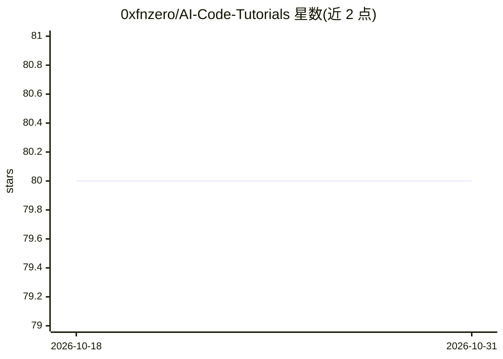

# 0xfnzero/AI-Code-Tutorials

⭐ 80 · MIT · 推送 2026-10-22 · [GitHub](https://github.com/0xfnzero/AI-Code-Tutorials) · [官网](https://fnzero.dev) · 个人维护 · 中文 README

**中英双语 AI 辅助编程教程集：覆盖 Claude Code 与 Codex**

面向零基础用户、独立开发者和专业工程师的中英双语 AI 编程教程仓库，共 16 课，内容覆盖 Claude Code 与 OpenAI Codex 的安装配置、CLI 命令、文件操作、Web 项目实战、提示词工程、代码审查、MCP 服务器、AI 子代理和 Codex 多端工作流（CLI/IDE/App/Cloud/GitHub review）。提供零基础、有基础、专业开发者和 Codex 用户四条学习路线，并声明按月核对官方文档、记录 CHANGELOG 的持续更新机制。教程以 Markdown 文档形式阅读，无安装步骤。

## 筛选速览

| 维度 | 判定 | 备注 |
|---|---|---|
| AI 角色 | `ai-knowledge` | 知识聚合/清单类 |
| 许可风险 | `permissive` | MIT |
| 部署形态 | `None` |  |
| 模型依赖 | — | README 未给出锁定关系 |
| 硬件要求 | — | 无带数字的原话,不猜 |
| 安装摩擦 | `low` | 无编译、无系统依赖或容器化 |
| 成熟度 | — | 结构信号不足 |

## 能力要点

- 16 课循序渐进覆盖入门、进阶、高级三阶段
- 覆盖 Claude Code 与 OpenAI Codex 双工具链
- 含 MCP 服务器配置指南与 AI 子代理系统专题
- 声明每月核对官方文档并记录 CHANGELOG 的持续更新机制

## 适用场景

- 零基础系统学习 Claude Code 或 OpenAI Codex
- 搭建提示词优化、MCP、AI 子代理等进阶工作流
- 团队按学习路线培训 AI 辅助编程实践

## 场景标签

`教程课程` · 领域:学习与行业

## 证据(README 行号)

> L2:  Claude Code 与 OpenAI Codex AI 辅助编程教程
> L35: ## 🔎 本教程覆盖什么
> L37: AI-Code-Tutorials 是一套中英双语 AI 辅助编程教程，面向零基础用户、独立开发者和专业工程师。当前内容覆盖 Claude Code 与 OpenAI Codex，从安装配置、第一次对话、CLI 命令、文件操作开始

## 星数曲线

2026-10-18 80 → 2026-10-31 80（+0）

---
*卡片 v1 · prompt 1.4 · 生成 2026-10-24 · 置信度 high · 依据 README sha `bf0852c0c6ac` · [字段定义](../../DATASET.md)*
