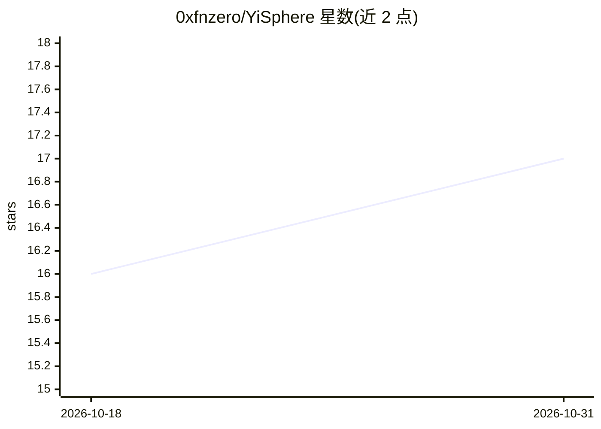

# 0xfnzero/YiSphere

⭐ 17 · Python · 推送 2026-10-22 · [GitHub](https://github.com/0xfnzero/YiSphere) · [官网](https://fnzero.dev/) · 个人维护 · 中文 README

**面向用户的 AI 传统术数对话应用：易经占卜、八字排盘、择日取名**

开源 Web 应用（FastAPI 后端 + 单页聊天前端 + SSE 流式回复），覆盖易经六爻起卦、八字四柱排盘、黄道吉日筛选、宝宝/公司取名、公历农历转换、奇门遁甲、紫微斗数等场景。核心机制是“程序负责计算，LLM 负责表达”：八字、黄历、卦象均由本地工具（sxtwl、cnlunar）计算后注入 LLM，模型只做解读且被要求不得改写计算结果。LLM 通过 OpenAI 兼容接口接入，默认配置为 DeepSeek，需自备 API Key；提供十余位“大师”角色对话。

## 筛选速览

| 维度 | 判定 | 备注 |
|---|---|---|
| AI 角色 | `ai-native` | 本体是模型或模型工具 |
| 许可风险 | `none` | — |
| 部署形态 | `library` | 以包/库形式分发 |
| 模型依赖 | locked-api |  |
| 硬件要求 | — | 无带数字的原话,不猜 |
| 安装摩擦 | `low` | 无编译、无系统依赖或容器化 |
| 成熟度 | — | 结构信号不足 |

## 能力要点

- 八字/黄历/起卦由本地程序计算后注入 LLM，提示词要求引用计算结果
- OpenAI 兼容接口接入，DeepSeek 为默认配置，可在 UI 配置 Base URL/Key/模型
- 十余位大师角色覆盖八字、六爻、奇门、风水、紫微、测字、解梦等
- 提供 /api/tools/* 系列工具接口（排盘、黄历、起卦、农历转换）

## 适用场景

- 本地运行的八字排盘、易经起卦、黄历择日、农历转换 Web 工具
- AI 占卜/命理产品原型或工具站、SaaS 的起点
- 研究 LLM + 结构化工具调用的中文应用开发

## 场景标签

`聊天机器人` · 领域:对话与助手

## 证据(README 行号)

> L4:  YiSphere 是一个开源的 AI 传统术数对话应用，支持 I Ching / 易经占卜、BaZi / 八字排盘、六爻起卦、黄道吉日查询、宝宝取名、公司取名、结婚择日、开业择日、农历公历转换等。用户用自然语言提问，系统自动计算八
> L46: 很多 AI 占卜项目直接让模型“凭空排盘”，容易把四柱、卦象、农历日期和黄历宜忌说错。YiSphere 的思路是：**程序负责计算，LLM 负责表达**。八字、农历转换、三枚铜钱法起卦、黄历择日都先由后端工具生成，模型只在这些结果

## 星数曲线

2026-10-18 16 → 2026-10-31 17（+1）

---
*卡片 v1 · prompt 1.4 · 生成 2026-10-30 · 置信度 mid · 依据 README sha `79035193d8fa` · [字段定义](../../DATASET.md)*
