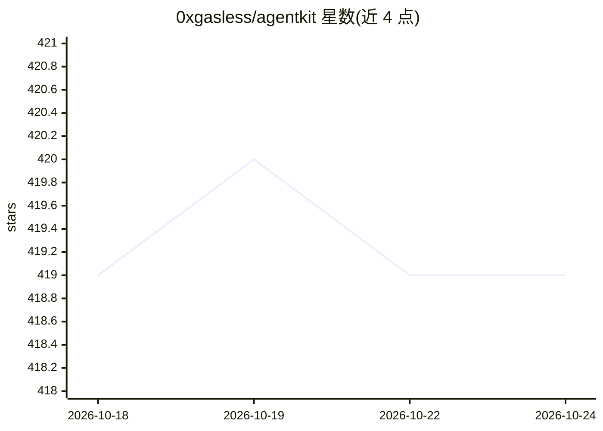

# 0xgasless/agentkit

⭐ 419 · TypeScript · NOASSERTION · 推送 2026-09-17 · [GitHub](https://github.com/0xgasless/agentkit) · [官网](https://docs.0xgasless.com) · 组织维护

**给 AI 代理配备加密钱包与链上操作能力的 SDK 工具包**

0xGasless AgentKit 将 0xGasless 平台封装为 AI 代理可调用的工具集：代理获得 KMS 托管钱包（进程内无私钥）与服务端强制支出策略，可执行稳定币支付（USDC/XSGD）、按次付费调用 x402 API 与 Tool Gateway 工具（浏览网页、抓取、搜索）、铸造 ERC-8004 链上身份与信誉查询，以及转账/兑换/跨链等 DeFi 操作；交易 gas 由 0xGasless facilitator 代付。另提供本地私钥自托管模式（ERC-4337 智能账户）。主网为 Avalanche C-Chain/Fuji，npm 包形式提供。

## 筛选速览

| 维度 | 判定 | 备注 |
|---|---|---|
| AI 角色 | `ai-ecosystem` | LLM/agent 周边工具 |
| 许可风险 | `none` | NOASSERTION |
| 部署形态 | `library` | 以包/库形式分发 |
| 模型依赖 | — | README 未给出锁定关系 |
| 硬件要求 | — | 无带数字的原话,不猜 |
| 安装摩擦 | `low` | 无编译、无系统依赖或容器化 |
| 成熟度 | — | 结构信号不足 |

## 能力要点

- KMS 托管钱包 + 服务端支出策略，代理无私钥
- x402 协议按次付费调用互联网 API，gas 由 facilitator 代付
- ERC-8004 链上身份注册与代理信誉查询/反馈
- 两种模式：平台托管与 ERC-4337 自托管

## 适用场景

- 让 AI 代理用自己的钱包按限额支付稳定币
- 为代理提供按次付费的网页浏览/抓取/搜索工具
- 代理间交易前核验对方链上信誉

## 场景标签

`Agent 框架` · 领域:Agent 开发

## 证据(README 行号)

> L12: 0xGasless AgentKit turns the 0xGasless platform
> L13: into a set of tools an AI agent can call. An agent gets a **KMS-custodied wallet**

## 星数曲线

2026-10-18 419 → 2026-10-24 419（+0）

---
*卡片 v1 · prompt 1.4 · 生成 2026-10-21 · 置信度 high · 依据 README sha `474e6257585a` · [字段定义](../../DATASET.md)*
