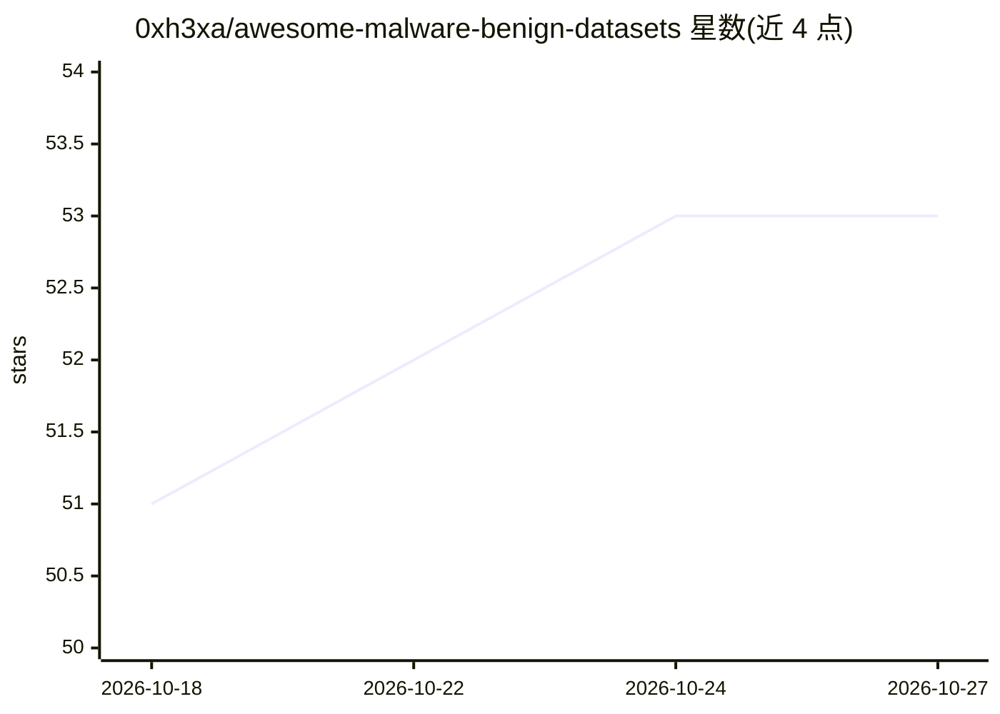

# 0xh3xa/awesome-malware-benign-datasets

⭐ 53 · CC0-1.0 · 推送 2026-01-31 · [GitHub](https://github.com/0xh3xa/awesome-malware-benign-datasets) · 个人维护

**恶意软件与良性样本数据集清单，供恶意软件研究**

面向网络安全研究者、AI 网络安全研究者与机器学习研究者的数据集策展清单：按 Windows、Android、文档三个类别组织表格，收录各数据集的年份、样本规模、标签类型、格式、描述与访问方式（Public/Restricted/Required）。条目覆盖 PE 二进制（EMBER、SOREL-20M、BODMAS）、Android APK（Drebin、AndroZoo、CICMalDroid）、恶意软件图像（Malimg、MalNet）与 PDF 文档等形态。仅提供链接与元数据，不包含下载或运行组件。

## 筛选速览

| 维度 | 判定 | 备注 |
|---|---|---|
| AI 角色 | `ai-knowledge` | 知识聚合/清单类 |
| 许可风险 | `viral` | CC0-1.0 |
| 部署形态 | `None` |  |
| 模型依赖 | — | README 未给出锁定关系 |
| 硬件要求 | — | 无带数字的原话,不猜 |
| 安装摩擦 | `low` | 无编译、无系统依赖或容器化 |
| 成熟度 | — | 结构信号不足 |

## 能力要点

- 按 Windows/Android/文档三类组织的数据集表格
- 每条含年份、样本规模、标签、格式与访问方式元数据
- 收录 EMBER2024 等较新基准（2025）

## 适用场景

- 为恶意软件分类/检测模型训练寻找数据集
- 对比不同平台（Windows/Android/文档）恶意软件数据集的规模与标签
- 确认某数据集的公开或受限访问状态

## 场景标签

`精选清单` `网络安全` · 领域:学习与行业

## 证据(README 行号)

> L5: A curated collection of high‑quality malware and benign datasets for cybersecurity researchers, AI Cybersecurity res
> L9: ## Windows Datasets

## 星数曲线

2026-10-18 51 → 2026-10-27 53（+2）

---
*卡片 v1 · prompt 1.4 · 生成 2026-10-24 · 置信度 high · 依据 README sha `f9ac72390583` · [字段定义](../../DATASET.md)*
