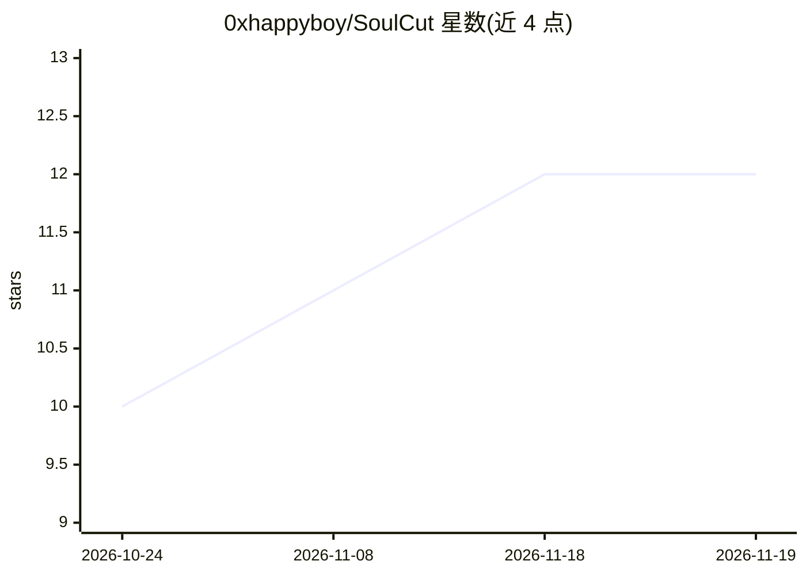

# 0xhappyboy/SoulCut

⭐ 12 · TypeScript · AGPL-3.0 · 推送 2026-11-15 · [GitHub](https://github.com/0xhappyboy/SoulCut) · [官网](https://soulcut-art.vercel.app/) · 个人维护 · 中文 README

**给创作者的离线优先本地桌面非线性剪辑系统**

基于 Rust 从零重写的 NLE 引擎与 Tauri 桌面应用的音视频非线性编辑器，支持 Windows/macOS/Linux。核心是多轨时间线、修剪、转场、调色、音频处理与导出；LLM 作为引擎之上的交互层，支持自然语言描述剪辑意图、处理选定片段、对齐节奏、控制调色/混音/时间线，以及生成视频/音频/图像素材直接插入时间线。强调离线优先：素材与项目留在本地，无 AI/无网络仍可完成手动剪辑到导出。

## 筛选速览

| 维度 | 判定 | 备注 |
|---|---|---|
| AI 角色 | `ai-enhanced` | 去掉 AI 部分产品仍成立 |
| 许可风险 | `viral` | AGPL-3.0 |
| 部署形态 | `desktop` | 安装包/桌面程序 |
| 模型依赖 | — | README 未给出锁定关系 |
| 硬件要求 | — | 无带数字的原话,不猜 |
| 安装摩擦 | `low` | 无编译、无系统依赖或容器化 |
| 成熟度 | — | 结构信号不足 |

## 能力要点

- 自研 Rust NLE 引擎，无 AI 也可完成多轨手动剪辑
- 自然语言描述剪辑意图，LLM 处理片段并对齐节奏
- 多模态素材生成直接进时间线，无需跨工具导入导出
- 15 滤镜、78 视效、15 运镜、26 转场与一键多平台导出

## 适用场景

- 无网络环境下本地完成从导入到导出的剪辑
- 用自然语言让 LLM 处理选定片段并对齐节奏
- 多轨时间线精细手动调整、调色与混音
- 移动设备同网络上传输素材到桌面剪辑项目

## 场景标签

`图像视频处理` · 领域:感知与多模态

## 证据(README 行号)

> L50: A free, locally-running desktop non-linear audio/video editor, supporting Windows / macOS / Linux.
> L52: SoulCut's underlying engine is a **fully self-developed NLE (non-linear editing) engine**. This means that even wit
> L56: - 🎬 **Conversational Editing** — Describe your intent in natural language. The LLM processes selected clips and ali

## 星数曲线

2026-10-24 10 → 2026-11-19 12（+2）

---
*卡片 v1 · prompt 1.4 · 生成 2026-11-18 · 置信度 high · 依据 README sha `eb8ea7dec504` · [字段定义](../../DATASET.md)*
