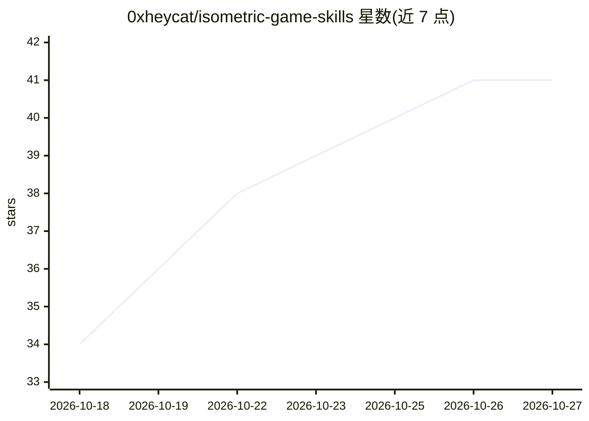

# 0xheycat/isometric-game-skills

⭐ 41 · Python · MIT · 推送 2026-08-12 · [GitHub](https://github.com/0xheycat/isometric-game-skills) · [官网](https://0xheycat.github.io/isometric-game-skills/demo/) · 个人维护

**等距游戏开发 AI agent 技能集（21 个 SKILL.md，覆盖美术到引擎）**

面向 AI 编程 agent（Claude Code/Cursor/Codex）的等距（isometric）游戏开发技能库：21 个 SKILL.md 格式技能，按阶段覆盖 ComfyUI 低显存 SDXL 美术生成、无缝地形与精灵资产、透明度清理与图集打包、Canvas2D 渲染与深度排序、A* 寻路、性能优化与资产管线自动化。技能通过复制到 agent 的 skills 目录或粘贴到上下文加载；附带单文件 Canvas2D 演示（GitHub Pages 可玩）、带单元测试的 iso.js 引擎与 CI 校验脚本。

## 筛选速览

| 维度 | 判定 | 备注 |
|---|---|---|
| AI 角色 | `ai-knowledge` | 知识聚合/清单类 |
| 许可风险 | `permissive` | MIT |
| 部署形态 | `None` |  |
| 模型依赖 | — | README 未给出锁定关系 |
| 硬件要求 | — | 无带数字的原话,不猜 |
| 安装摩擦 | `low` | 无编译、无系统依赖或容器化 |
| 成熟度 | — | 结构信号不足 |

## 能力要点

- 21 个 SKILL.md 技能覆盖美术生成→资产处理→引擎渲染→玩法系统→上线全流程
- 含 ComfyUI 12GB 显存 SDXL 设置与无缝等距地形生成技能
- 附带依赖为零的单文件 Canvas2D 等距渲染器在线演示
- engine/iso.js 网格数学带单元测试，validate_skills.py 做 CI 校验

## 适用场景

- 让 Claude Code/Cursor 等 agent 按流程生成风格一致的等距游戏资产
- 搭建带深度排序与拾取交互的 Canvas2D 等距渲染器
- 用 ComfyUI 管线批量产出无缝地形与精灵图集

## 场景标签

`编码 Agent` `图像生成` `提示工程` · 领域:Agent 开发

## 证据(README 行号)

> L17: This repo is that knowledge, encoded as **SKILL.md** files an agent can load on demand. Point Claude Code, Cursor, 
> L65: **21 skills** covering the full isometric game pipeline, grouped by phase. Run them in order, or load just the one 
> L130: Each skill is a single `SKILL.md` with YAML frontmatter and a fixed anatomy designed to **stop an agent from cutti

## 星数曲线

2026-10-18 34 → 2026-10-27 41（+7）

---
*卡片 v1 · prompt 1.4 · 生成 2026-10-25 · 置信度 high · 依据 README sha `f766b647879a` · [字段定义](../../DATASET.md)*
