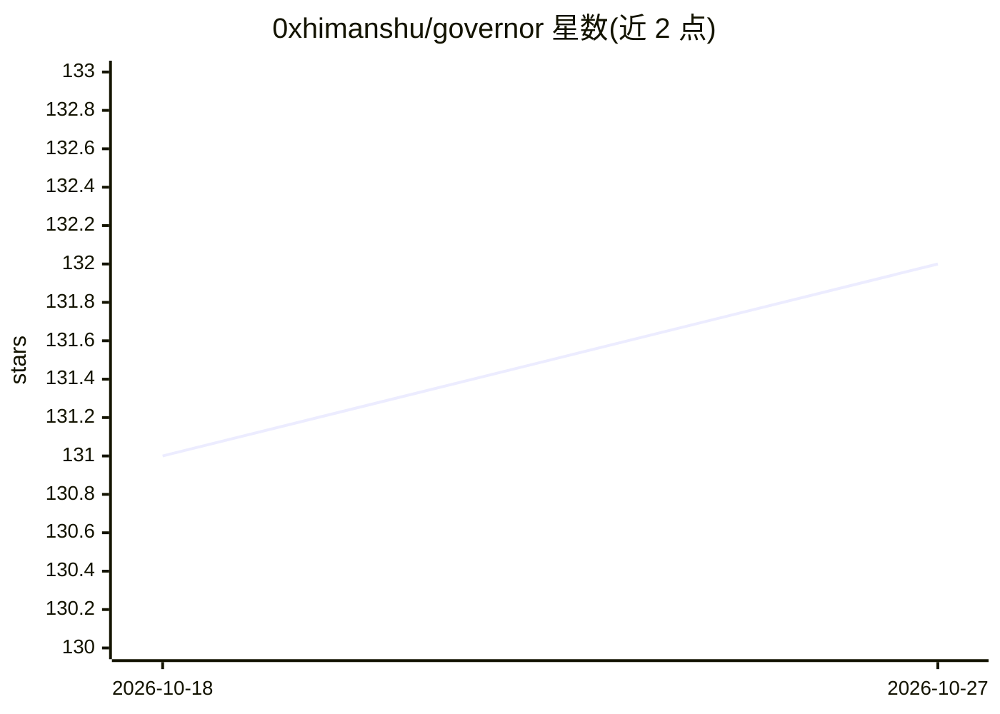

# 0xhimanshu/governor

⭐ 132 · Python · MIT · 推送 2026-09-06 · [GitHub](https://github.com/0xhimanshu/governor) · [官网](https://github.com/0xhimanshu/governor) · 个人维护

**面向 AI 编码代理的上下文治理插件：工具输出过滤与记忆压缩**

最初作为 Claude Code 插件提供工具输出过滤、紧凑模式、记忆压缩、遥测与偏移防护；v0.2.4 起通过基于 prompt 的规则文件扩展至 Cursor、Windsurf、Cline、Codex CLI、Gemini CLI、Hermes、DeepSeek 共 8 种代理，无需 hooks 或 MCP。核心机制：重复行超过 40% 的噪声输出被压缩（保留首个错误、file:line、退出码），唯一数据原样通过；提供 /governor:* 五个命令（状态、模式、审计、压缩、计划）与受保护片段校验、低节省拒绝回滚机制。Claude Code 获得最深集成，其他代理获得核心行为。

## 筛选速览

| 维度 | 判定 | 备注 |
|---|---|---|
| AI 角色 | `ai-ecosystem` | LLM/agent 周边工具 |
| 许可风险 | `permissive` | MIT |
| 部署形态 | `None` |  |
| 模型依赖 | — | README 未给出锁定关系 |
| 硬件要求 | — | 无带数字的原话,不猜 |
| 安装摩擦 | `low` | 无编译、无系统依赖或容器化 |
| 成熟度 | — | 结构信号不足 |

## 能力要点

- 内容感知的工具输出过滤（重复行>40% 才压缩，唯一数据直通），支持 8 种代理
- 记忆压缩带受保护片段校验与低节省拒绝回滚
- 遥测账本与状态面板报告拦截 token、失败与压缩情况
- /governor:plan 写实施契约并检测范围偏移

## 适用场景

- 长会话 Claude Code 用户在配额压力下控制上下文膨胀
- 多代理团队在同一代码库统一上下文卫生规则
- MCP 密集工作流中压缩大型结构化工具输出
- 压缩臃肿的 CLAUDE.md 等提示文件

## 场景标签

`Agent 记忆` · 领域:Agent 开发

## 证据(README 行号)

> L27: Governor started as a Claude Code plugin for context hygiene, tool-output
> L30: **As of v0.2.4, Governor's core behavior — content-aware tool-output filtering
> L71: |**Claude Code**|Plugin with hooks|Full: auto-filtering, telemetry, compression, drift guard, `/governor:*` command

## 星数曲线

2026-10-18 131 → 2026-10-27 132（+1）

---
*卡片 v1 · prompt 1.4 · 生成 2026-10-23 · 置信度 high · 依据 README sha `7b95ee7c70fc` · [字段定义](../../DATASET.md)*
