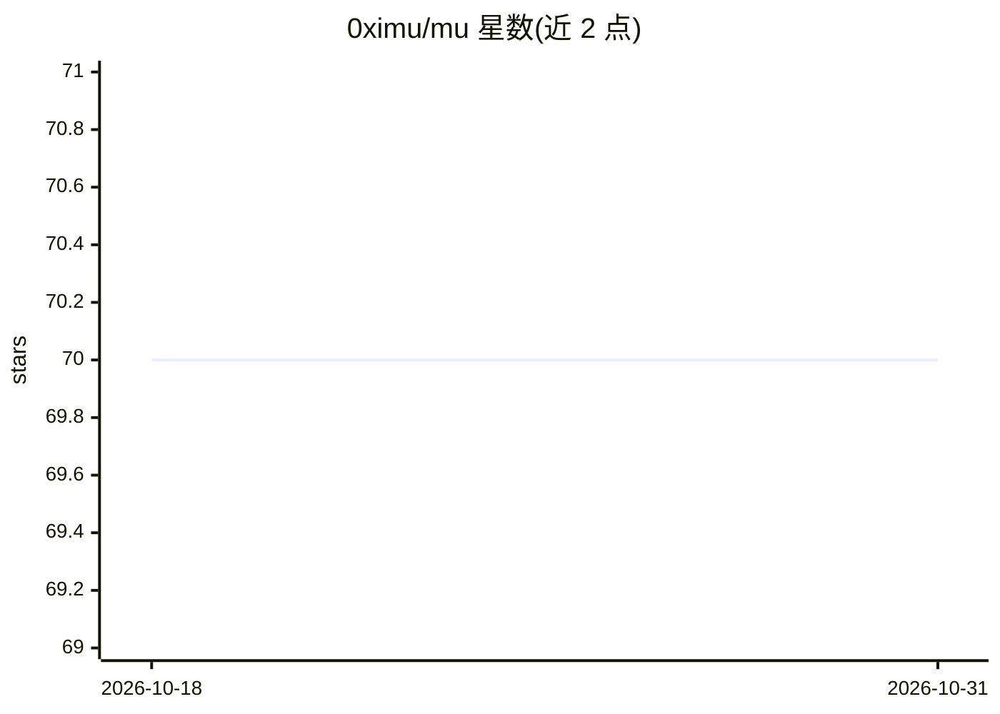

# 0ximu/mu

⭐ 70 · Rust · Apache-2.0 · 推送 2026-09-22 · [GitHub](https://github.com/0ximu/mu) · 个人维护

**给 AI 助手提供代码库深度理解的 MCP 服务器**

用 Rust 编写的 MCP server，通过 tree-sitter 解析代码库构建语义图（文件/类/函数节点与导入、调用、继承等边），存入 DuckDB，并以 13 个 MCP 工具暴露给 AI 助手：BM25 搜索、符号查找、图遍历、下游影响分析、语义 diff、PR 审查、代码审计、按 token 预算的重要性排序压缩等。支持 Python/TS/JS/Go/Rust/Java/C# 七种语言。面向使用 Claude Code 等 MCP 客户端的开发者，替代把整个仓库塞进上下文窗口的做法。限制：DuckDB 单写者，bootstrap 需先停掉 MCP server；测试覆盖检测依赖同目录测试文件。

## 筛选速览

| 维度 | 判定 | 备注 |
|---|---|---|
| AI 角色 | `ai-ecosystem` | LLM/agent 周边工具 |
| 许可风险 | `permissive` | Apache-2.0 |
| 部署形态 | `None` |  |
| 模型依赖 | locked-api |  |
| 硬件要求 | — | 无带数字的原话,不猜 |
| 安装摩擦 | `medium` | 含编译或系统依赖之一 |
| 成熟度 | — | 结构信号不足 |

## 能力要点

- tree-sitter 解析 + DuckDB 存储 + PageRank 重要性评分的语义图构建
- 13 个 MCP 工具：BM25 搜索、影响分析、PR 审查、代码审计等
- mu_compress 按 token 预算输出重要性排序的代码库概览
- mu_enrich 循环让 LLM 写摘要回存，逐步改进后续搜索

## 适用场景

- 让 Claude Code 等客户端在大型代码库中做导航、审查与影响分析
- 把整个代码库压缩进有限 token 预算喂给 LLM
- 改动前查询某符号的下游依赖（含 DI 与消息总线消费者）

## 场景标签

`代码审查` · 领域:编码与开发

## 证据(README 行号)

> L5:  MCP server that gives AI assistants deep codebase understanding.
> L8: MU parses your codebase into a semantic graph stored in DuckDB, then exposes it through 13 MCP tools. Your AI assist

## 星数曲线

2026-10-18 70 → 2026-10-31 70（+0）

---
*卡片 v1 · prompt 1.4 · 生成 2026-10-24 · 置信度 high · 依据 README sha `93c0441d8d40` · [字段定义](../../DATASET.md)*
