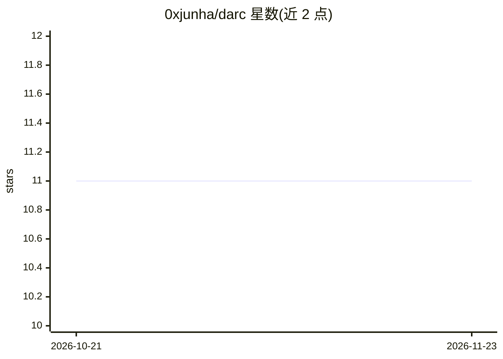

# 0xjunha/darc

⭐ 11 · Rust · MIT · 推送 2026-07-03 · [GitHub](https://github.com/0xjunha/darc) · 个人维护

**为 coding agent 提供历史会话检索与团队共享的 CLI 工具**

Rust 编写的 CLI 工具：把 Codex 与 Claude Code 的本地会话日志增量同步进 SQLite 索引，通过 search/list/show 等读 API 让 agent 迭代检索过往会话并引用精确证据。不做摘要、不决定注入哪些记忆。支持 age 加密后经 Git 分支共享加密索引给团队，共享前对常见密钥等做脱敏。通过安装脚本安装，支持 macOS/Linux，自动刷新仅限 macOS。

## 筛选速览

| 维度 | 判定 | 备注 |
|---|---|---|
| AI 角色 | `ai-ecosystem` | LLM/agent 周边工具 |
| 许可风险 | `permissive` | MIT |
| 部署形态 | `None` |  |
| 模型依赖 | — | README 未给出锁定关系 |
| 硬件要求 | — | 无带数字的原话,不猜 |
| 安装摩擦 | `low` | 无编译、无系统依赖或容器化 |
| 成熟度 | — | 结构信号不足 |

## 能力要点

- 将 Codex/Claude Code 会话日志增量索引为本地 SQLite，支持结构化检索
- 返回 session_id/turn_ordinal 等证据句柄，agent 可引用精确出处
- age 加密 + Git 后端的团队索引共享，存储前脱敏
- 提供 search/list/show/stats 等 CLI 命令与 agent 使用指引

## 适用场景

- 让 agent 在改动前检索过往调试与实现决策的证据
- 团队间通过 Git 分支共享加密的 agent 会话索引
- 查找曾触碰某文件或共变文件的会话

## 场景标签

`Agent 记忆` · 领域:Agent 开发

## 证据(README 行号)

> L9: **A CLI search tool over past agent work + Git-backed sharing**
> L25: How Darc works: raw Codex and Claude Code logs are incrementally synced into a local SQLite index, queried through 

## 星数曲线

2026-10-21 11 → 2026-11-23 11（+0）

---
*卡片 v1 · prompt 1.4 · 生成 2026-11-19 · 置信度 high · 依据 README sha `5b0da6179f24` · [字段定义](../../DATASET.md)*
