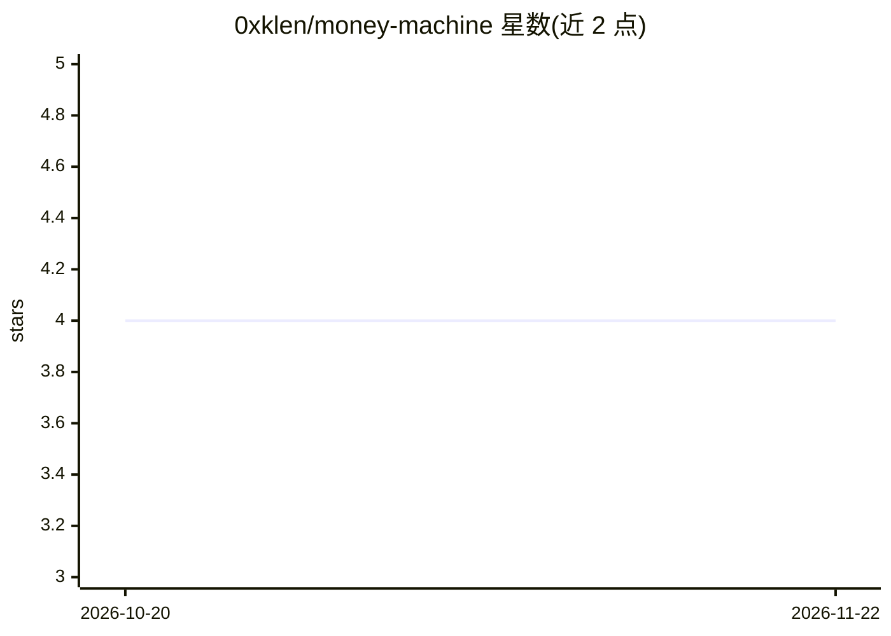

# 0xklen/money-machine

⭐ 4 · Python · MIT · 推送 2026-10-08 · [GitHub](https://github.com/0xklen/money-machine) · 个人维护

**为 AI agent 提供 1040 个赚钱机器构建技能的 Markdown 程序库**

一个技能集合仓库：1040 个 Markdown 文件，每个是一个 agent 可直接遵循的操作流程（含 Procedure、Pitfalls、Verification），覆盖 52 个领域——agent 管理、软件工程、加密货币、安全、数据、性能、产品、定价与收入运营。技能以纯 Markdown 编写，工具为仅依赖标准库的 Python 3，无需构建或第三方依赖；通过复制到 agent 技能目录安装，自带验证脚本检查技能有效性并拒绝存根与重复条目。

## 筛选速览

| 维度 | 判定 | 备注 |
|---|---|---|
| AI 角色 | `ai-knowledge` | 知识聚合/清单类 |
| 许可风险 | `permissive` | MIT |
| 部署形态 | `None` |  |
| 模型依赖 | — | README 未给出锁定关系 |
| 硬件要求 | — | 无带数字的原话,不猜 |
| 安装摩擦 | `low` | 无编译、无系统依赖或容器化 |
| 成熟度 | — | 结构信号不足 |

## 能力要点

- 1040 个技能、52 个领域，含验证器保证 1040/1040 有效、0 失败、0 重复
- 纯 Markdown 技能 + 标准库 Python 工具，无构建、无第三方依赖
- 兼容 Hermes Agent / Claude Code / Codex 的技能目录安装方式
- 提供自定义技能模板与验证流程

## 适用场景

- 为支持技能目录的 AI agent 批量加载操作流程技能
- 按 crypto、安全、DevOps 等领域扩展 agent 的任务处理能力
- 编写并验证自己的 agent 技能并纳入该体系

## 场景标签

 · 领域:AI agent 技能库

## 证据(README 行号)

> L21: 1040 files, each one a procedure an agent can follow without asking questions. Every skill
> L43: cp -r skills/* ~/.claude/skills/     # Claude Code

## 星数曲线

2026-10-20 4 → 2026-11-22 4（+0）

---
*卡片 v1 · prompt 1.4 · 生成 2026-11-21 · 置信度 high · 依据 README sha `884db54567a3` · [字段定义](../../DATASET.md)*
