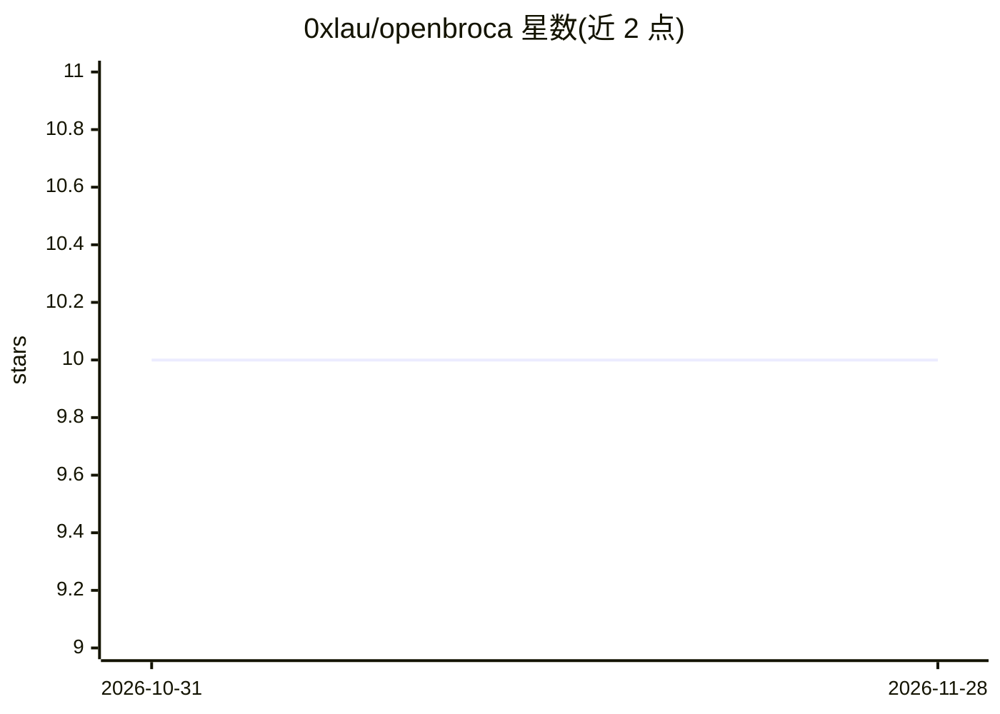

# 0xlau/openbroca

⭐ 10 · TypeScript · MIT · 推送 2026-07-29 · [GitHub](https://github.com/0xlau/openbroca) · [官网](https://openbroca.com) · 个人维护

**跨平台桌面语音输入工具：对任意应用语音听写并转写改写**

基于 Electron 的系统级语音输入桌面应用：录制麦克风音频，经可插拔的 ASR 与 LLM provider 注册表完成转写与文本改写/润色/转换，结果送回当前聚焦的应用或剪贴板。提供 provider 契约与中间件机制，凭据存于操作系统安全存储，本地优先、不绑定单一厂商。项目处于 pre-1.0 阶段，提供 macOS（Apple Silicon/Intel）与 Windows x64 安装包，macOS/Windows 构建可能未签名；也可从源码运行开发。

## 筛选速览

| 维度 | 判定 | 备注 |
|---|---|---|
| AI 角色 | `ai-native` | 本体是模型或模型工具 |
| 许可风险 | `permissive` | MIT |
| 部署形态 | `desktop` | 安装包/桌面程序 |
| 模型依赖 | — | README 未给出锁定关系 |
| 硬件要求 | — | 无带数字的原话,不猜 |
| 安装摩擦 | `low` | 无编译、无系统依赖或容器化 |
| 成熟度 | `idea` | |

## 能力要点

- 系统级听写：向任意聚焦应用输送语音转写文本
- 可插拔 ASR/LLM provider 注册表，支持本地与云端切换
- LLM 中间件机制与模型选择、provider 设置管理
- 凭据存放于 OS 级安全存储，本地优先架构

## 适用场景

- 在任意桌面应用里用语音代替键盘输入文字
- 口述后由 LLM 自动润色、改写、转换文本
- 在本地 ASR 与云端 ASR 之间切换听写方案
- 基于开放 provider 接口扩展自定义语音工作流

## 场景标签

`语音识别` `AI 写作` · 领域:内容生成

## 证据(README 行号)

> L13:  It turns speech into text, intent into action, and your voice into a system-wide input layer.
> L63: - Speak naturally, then let OpenBroca transcribe, clean up, and deliver text where you need it.
> L116: Openbroca Origin is pre-1.0 software. The repository is active, usable for development, and currently focused on d

## 星数曲线

2026-10-31 10 → 2026-11-28 10（+0）

---
*卡片 v1 · prompt 1.4 · 生成 2026-11-20 · 置信度 mid · 依据 README sha `85caaeaf31c7` · [字段定义](../../DATASET.md)*
