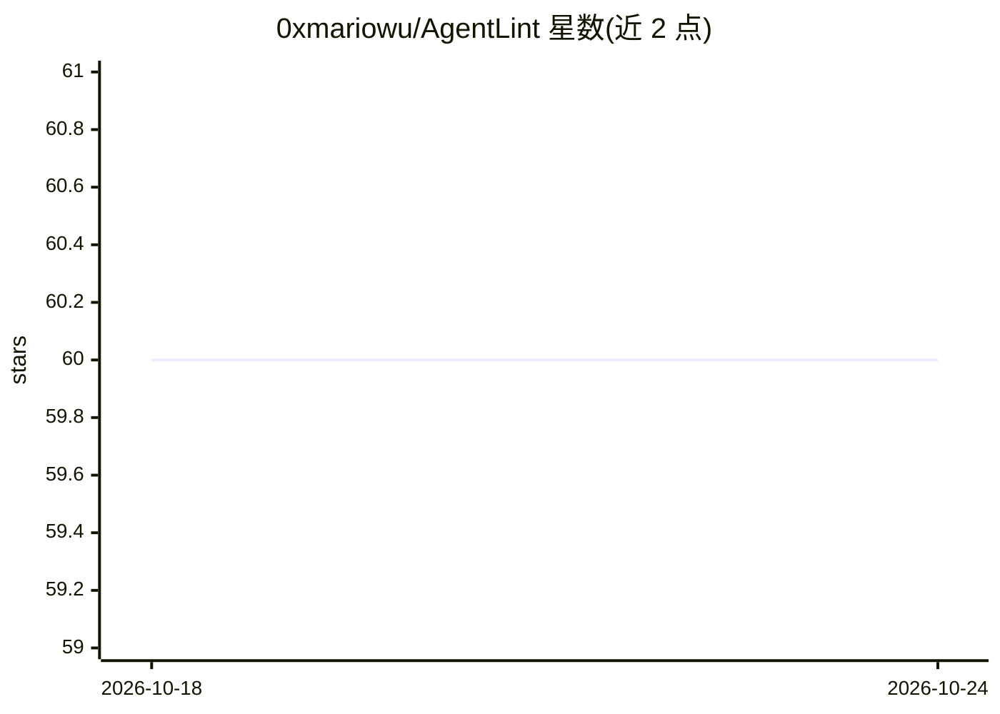

# 0xmariowu/AgentLint

⭐ 60 · Shell · MIT · 推送 2026-10-10 · [GitHub](https://github.com/0xmariowu/AgentLint) · [官网](https://agentlint.app) · 个人维护 · 中文 README

**面向 AI 编码代理的 harness 配置检查工具（58 项检查）**

对包裹 LLM 的代理 harness（AGENTS.md/CLAUDE.md、CI 配置、hooks、.gitignore 等）做静态审计的 CLI 工具：默认运行 51 项确定性检查，覆盖可发现性、指令质量、可构建性、连续性、安全性、Claude Code 配置 6 个维度并输出 0-100 评分；另有 7 项可选扩展检查（3 项 AI 子代理分析、4 项读取本地 Claude Code 会话日志）。检查依据来自 265 个版本的 Claude Code 系统提示词追踪、Claude Code 源码限制（40K 字符截断、256KB 读取上限）及论文。以 npm 包安装，可作为 Claude Code 插件（/al 命令）或独立 CLI/GitHub Action 使用。

## 筛选速览

| 维度 | 判定 | 备注 |
|---|---|---|
| AI 角色 | `ai-ecosystem` | LLM/agent 周边工具 |
| 许可风险 | `permissive` | MIT |
| 部署形态 | `library` | 以包/库形式分发 |
| 模型依赖 | — | README 未给出锁定关系 |
| 硬件要求 | — | 无带数字的原话,不猜 |
| 安装摩擦 | `low` | 无编译、无系统依赖或容器化 |
| 成熟度 | — | 结构信号不足 |

## 能力要点

- 51 项确定性核心检查，覆盖 6 个维度并输出 0-100 评分
- 7 项可选扩展检查：AI 子代理指令分析与 Claude Code 会话日志读取
- 检查规则引用 Claude Code 硬限制（40K 字符截断、256KB 文件不可读）
- 提供 CLI、Claude Code /al 插件与 GitHub Action 三种运行方式

## 适用场景

- 审计团队仓库中 CLAUDE.md/AGENTS.md 等 AI 上下文文件的质量
- 在 CI 中拦截会误导编码代理的配置问题（密钥泄露、超长入口文件等）
- 基于 Claude Code 会话日志发现被反复忽略的规则与摩擦点

## 场景标签

`提示工程` · 领域:Agent 开发

## 证据(README 行号)

> L3:  The linter for your agent harness.
> L17: > Your `AGENTS.md`, `CLAUDE.md`, CI config, hooks, and `.gitignore` *are* the harness. When they're wrong, Claude C
> L91: **58 checks total: 51 deterministic core checks across 6 dimensions (always run), plus 7 opt-in extended checks** (

## 星数曲线

2026-10-18 60 → 2026-10-24 60（+0）

---
*卡片 v1 · prompt 1.4 · 生成 2026-10-24 · 置信度 high · 依据 README sha `3ee4b8833daf` · [字段定义](../../DATASET.md)*
