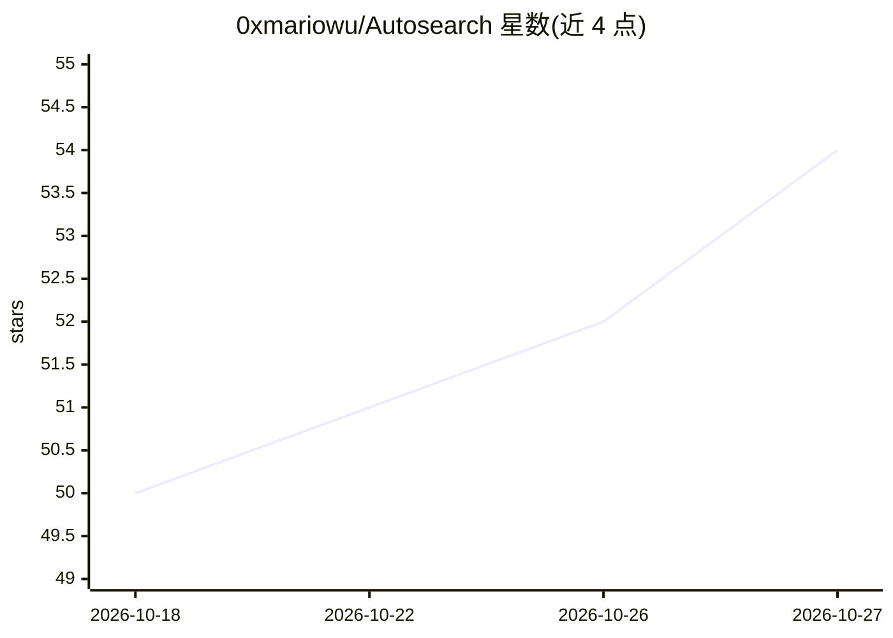

# 0xmariowu/Autosearch

⭐ 54 · Python · MIT · 推送 2026-10-24 · [GitHub](https://github.com/0xmariowu/Autosearch) · [官网](https://www.autosearch.dev) · 个人维护 · 中文 README

**给 AI agent 的 MCP 原生深度搜索工具：接入 40 个信息渠道**

面向 AI agent 的开源深度研究基础设施：以 MCP 原生方式向 Claude Code、Cursor、Cline、GPT-Researcher、LangChain、LlamaIndex、AutoGen 等 agent 宿主提供 40 个渠道的搜索访问，含 10+ 中文信息源（微信公众号、小红书、微博、知乎、B 站、雪球等）。引擎返回去重排序的多源结果并附来源 URL，与 LLM 调用解耦，agent 保留自己的模型与工作流。提供 npx、curl 脚本等安装方式；部分渠道（Twitter、Bilibili、小红书等）需配置 TIKHUB_API_KEY 等密钥。

## 筛选速览

| 维度 | 判定 | 备注 |
|---|---|---|
| AI 角色 | `ai-ecosystem` | LLM/agent 周边工具 |
| 许可风险 | `permissive` | MIT |
| 部署形态 | `library` | 以包/库形式分发 |
| 模型依赖 | — | README 未给出锁定关系 |
| 硬件要求 | — | 无带数字的原话,不猜 |
| 安装摩擦 | `low` | 无编译、无系统依赖或容器化 |
| 成熟度 | — | 结构信号不足 |

## 能力要点

- 40 个搜索渠道，含 arxiv、PubMed、GitHub、Hacker News、Stack Overflow 等
- 10+ 中文信息源：微信公众号、小红书、微博、知乎、B 站、雪球等
- MCP 原生、与 LLM 解耦，结果去重排序并附来源 URL
- 27 个渠道免配置即用，autosearch doctor 检查渠道状态

## 适用场景

- 让 Claude Code / Cursor 等 agent 编程助手直接检索多渠道资料
- 需要中文社媒与技术社区信息的 agent 深度研究
- 为 agent 接入学术、开发者社区与新闻等多源检索

## 场景标签

`语义搜索` `网页抓取` · 领域:效率与自动化

## 证据(README 行号)

> L17: AutoSearch is open-source deep research infrastructure built for AI agents. Plug Claude Code, Cursor, Cline, GPT-Re
> L19: The engine returns indexed multi-source results and stays uncoupled from LLM calls, so your agent keeps its own mod

## 星数曲线

2026-10-18 50 → 2026-10-27 54（+4）

---
*卡片 v1 · prompt 1.4 · 生成 2026-10-24 · 置信度 high · 依据 README sha `620a0e9542db` · [字段定义](../../DATASET.md)*
