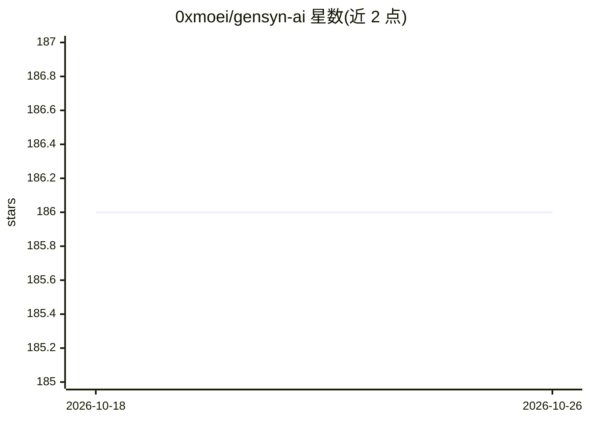

# 0xmoei/gensyn-ai

⭐ 186 · MIT · 推送 2025-11-21 · [GitHub](https://github.com/0xmoei/gensyn-ai) · 个人维护

**Gensyn RL-Swarm 测试网节点搭建教程**

由个人维护的分步指南，讲解如何运行 GensynAI 开源的 RL Swarm 强化学习训练群测试网节点：覆盖 Windows/云 GPU/VPS 三种环境准备、系统依赖与 Python/Node.js/Yarn 安装、HuggingFace 令牌获取、克隆官方仓库并以 CLI 或 Docker 方式启动节点、网页登录与 Judge 预测市场加入，以及多节点运行、swarm.pem 备份恢复与 Telegram 监控等维护操作。硬件要求随所选模型而异，支持 CPU-only（≥32GB 内存）与多款 GPU。

## 筛选速览

| 维度 | 判定 | 备注 |
|---|---|---|
| AI 角色 | `ai-knowledge` | 知识聚合/清单类 |
| 许可风险 | `permissive` | MIT |
| 部署形态 | `self-host` | docker 或自建部署 |
| 模型依赖 | — | README 未给出锁定关系 |
| 硬件要求 | `cpu-ok` | |
| 安装摩擦 | `low` | 无编译、无系统依赖或容器化 |
| 成熟度 | `idea` | |

## 能力要点

- 覆盖 Windows 本机、Vast.ai/QuickPod/Hyperbolic 云 GPU、VPS 三类环境
- CLI 与 Docker（CPU/GPU/Mac）两种节点启动方式
- 列明 5 个默认支持模型及对应硬件梯度
- 包含多节点、swarm.pem 备份恢复、Gswarm Telegram 监控等维护章节

## 适用场景

- 按教程在本地或租用 GPU 上运行 Gensyn 测试网节点
- 参与 RL Swarm 的 Judge AI 预测市场
- 在低配硬件上选择小模型运行 CPU-only 节点

## 场景标签

`教程课程` · 领域:学习与行业

## 证据(README 行号)

> L3: # Run RL Swarm (Testnet) Node
> L4: RL Swarm is a fully open-source framework developed by GensynAI for building reinforcement learning (RL) training sw
> L32: * This guide is going through the easiet default way to participate on testnet, you can checkout Official Repo for 

## 星数曲线

2026-10-18 186 → 2026-10-26 186（+0）

---
*卡片 v1 · prompt 1.4 · 生成 2026-10-22 · 置信度 mid · 依据 README sha `1443325ee152` · [字段定义](../../DATASET.md)*
