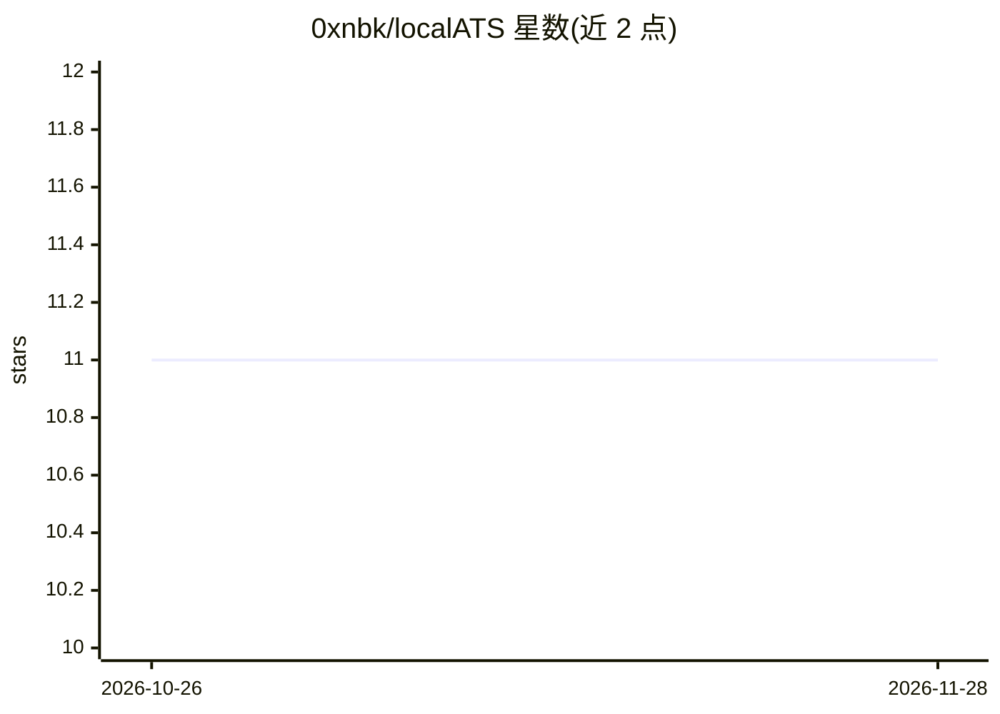

# 0xnbk/localATS

⭐ 11 · TypeScript · Apache-2.0 · 推送 2026-06-01 · [GitHub](https://github.com/0xnbk/localATS) · [官网](https://localats.com) · 个人维护

**浏览器本地运行的 AI 简历 ATS 匹配评分工具**

localATS 是一个在浏览器端运行的 ATS 简历分析工具：用户粘贴或上传 PDF 的简历与职位描述，由 Transformers.js + ONNX Runtime Web 在设备本地推理，输出语义与领域兼容性评分，数据不经过后端。模型来自作者发布的两个 Hugging Face 模型，可配置从本地或远程路径加载。项目处于 beta 阶段，提供 Vite 开发/构建脚本与 Cloudflare Workers 部署配置，Apache 2.0 许可。

## 筛选速览

| 维度 | 判定 | 备注 |
|---|---|---|
| AI 角色 | `ai-native` | 本体是模型或模型工具 |
| 许可风险 | `permissive` | Apache-2.0 |
| 部署形态 | `library` | 以包/库形式分发 |
| 模型依赖 | — | README 未给出锁定关系 |
| 硬件要求 | — | 无带数字的原话,不猜 |
| 安装摩擦 | `low` | 无编译、无系统依赖或容器化 |
| 成熟度 | `idea` | |

## 能力要点

- Transformers.js + ONNX Runtime Web 浏览器内本地推理，无需后端处理简历
- 支持粘贴文本与 PDF 输入，输出语义与领域兼容性评分
- 自带两个 Hugging Face 模型：语义模型与领域模型
- 提供本地开发、构建脚本与 Cloudflare Workers 部署配置

## 适用场景

- 求职者投递前在本地检查简历与职位描述的匹配度
- 不希望简历数据上传到第三方服务时做隐私优先分析
- 开发者自托管部署一个本地简历评分站点

## 场景标签

 · 领域:求职/简历工具

## 证据(README 行号)

> L10: localATS is a browser-based ATS resume analyzer that runs AI locally on your device. Resume and job description dat
> L15: - Local inference with Transformers.js + ONNX Runtime Web
> L89: - Semantic model: `0xnbk/nbk-ats-semantic-v1-en`

## 星数曲线

2026-10-26 11 → 2026-11-28 11（+0）

---
*卡片 v1 · prompt 1.4 · 生成 2026-11-19 · 置信度 high · 依据 README sha `07970789da92` · [字段定义](../../DATASET.md)*
