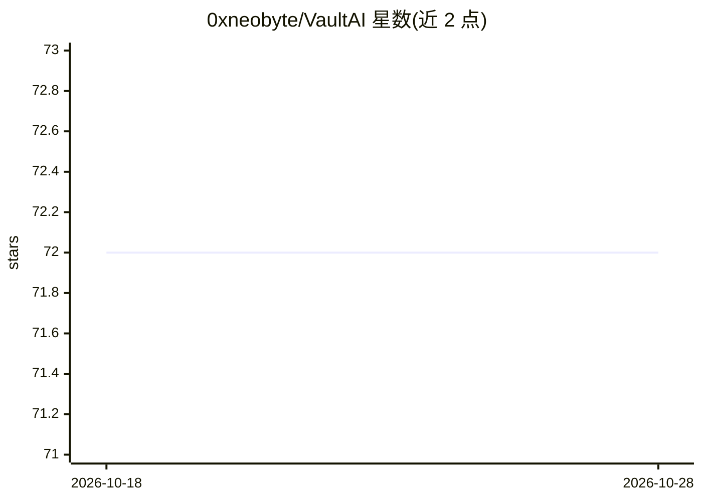

# 0xneobyte/VaultAI

⭐ 72 · TypeScript · MIT · 推送 2026-10-19 · [GitHub](https://github.com/0xneobyte/VaultAI) · 个人维护

**Obsidian 的 Gemini 聊天插件：笔记摘要、内容生成与全库 RAG 问答**

面向 Obsidian 用户的 AI 写作助手插件，接入 Google Gemini API：提供聊天界面、自定义提示词系统、光标处插入 AI 回复的编辑器集成，以及基于 Gemini File Search API 的全库 RAG 语义搜索，回答附带笔记引用。模型参数（temperature、top-K、top-P、token 上限）可配置。安装途径为 Obsidian 社区插件市场，需自备 Gemini API key（有免费层），要求 Obsidian v0.15.0+。API key 与聊天历史存储在本地 vault 中。

## 筛选速览

| 维度 | 判定 | 备注 |
|---|---|---|
| AI 角色 | `ai-native` | 本体是模型或模型工具 |
| 许可风险 | `permissive` | MIT |
| 部署形态 | `None` |  |
| 模型依赖 | — | README 未给出锁定关系 |
| 硬件要求 | — | 无带数字的原话,不猜 |
| 安装摩擦 | `low` | 无编译、无系统依赖或容器化 |
| 成熟度 | — | 结构信号不足 |

## 能力要点

- 基于 Gemini File Search API 的全库 RAG 语义搜索，回答带引用
- AI 回复直接插入光标位置，实时感知上下文
- 可复用自定义提示词系统（含智能占位符）
- API key 与聊天历史保存在本地 vault

## 适用场景

- 在 Obsidian 中对整个笔记库提问并获得带引用的回答
- 写作时在光标处生成或续写内容
- 用可复用提示词固化重复性写作流程

## 场景标签

`聊天机器人` `AI 写作` `文档问答` · 领域:对话与助手

## 证据(README 行号)

> L10: Transform your note-taking with an intelligent AI writing assistant powered by Google's Gemini AI. VaultAI brings d
> L16: - **🧠 RAG (Retrieval Augmented Generation)** - Search across your entire vault with AI-powered semantic search usin
> L40: Transform your entire vault into an AI-powered knowledge base! VaultAI now supports RAG (Retrieval Augmented Genera

## 星数曲线

2026-10-18 72 → 2026-10-28 72（+0）

---
*卡片 v1 · prompt 1.4 · 生成 2026-10-24 · 置信度 high · 依据 README sha `90e57839145a` · [字段定义](../../DATASET.md)*
