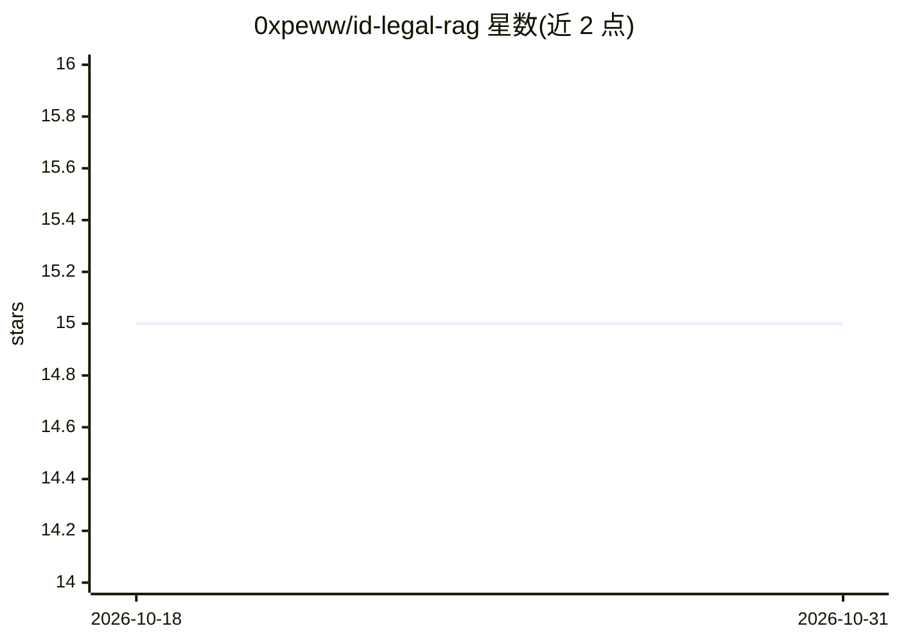

# 0xpeww/id-legal-rag

⭐ 15 · Python · MIT · 推送 2026-06-03 · [GitHub](https://github.com/0xpeww/id-legal-rag) · 个人维护

**印尼法律文档的混合 RAG 管线，本地 LLM 驱动合规问答**

面向印尼 SME 合规场景的检索增强生成管线：爬取 peraturan.go.id、最高法院判决门户等公开法律文本，做 Pasal 结构感知的分块，检索采用 BM25 与稠密向量混合并经 cross-encoder 重排，LLM 通过 Ollama 本地运行（llama3.1 或 qwen2.5），生成答案强制引用 Pasal 条号并对未检索到的引用做拒绝校验。嵌入与推理依赖 AMD ROCm GPU（MI250/MI300X）以缩短重索引时间。以 notebook 加薄 Python 层形式提供，含样本数据可端到端运行。已知限制：分块器在部分 PDF 排版的法律上失效，重排器未针对印尼语微调。

## 筛选速览

| 维度 | 判定 | 备注 |
|---|---|---|
| AI 角色 | `ai-native` | 本体是模型或模型工具 |
| 许可风险 | `permissive` | MIT |
| 部署形态 | `library` | 以包/库形式分发 |
| 模型依赖 | local-ok | 支持本地模型 |
| 硬件要求 | — | 无带数字的原话,不猜 |
| 安装摩擦 | `low` | 无编译、无系统依赖或容器化 |
| 成熟度 | — | 结构信号不足 |

## 能力要点

- Pasal 结构感知的法律文档分块
- BM25 + 稠密检索混合并 cross-encoder 重排
- 引用接地：LLM 必须返回 Pasal 号并对未检索引用做拒绝校验
- Ollama 本地运行 llama3.1 / qwen2.5 模型

## 适用场景

- 对印尼法律（UU/PP/Perpres/判决）做带条文引用的问答
- 为 SME 合规工作检索相关法律法规
- 在 ROCm GPU 工作站上端到端重索引法律语料库

## 场景标签

`RAG` `文档问答` · 领域:知识与检索

## 证据(README 行号)

> L3: > A retrieval-augmented generation pipeline for Indonesian legal documents — laws, court decisions, ministerial regu
> L7: The model running on top is local — `ollama` with either `llama3.1:8b-instruct-q4_K_M` or `qwen2.5:7b-instruct` depe
> L21: 2. **Hybrid retrieval** — BM25 dominates on exact-citation queries ("Pasal 1320 KUHPerdata"). Dense retrieval domin

## 星数曲线

2026-10-18 15 → 2026-10-31 15（+0）

---
*卡片 v1 · prompt 1.4 · 生成 2026-10-31 · 置信度 high · 依据 README sha `8d9e41823f0f` · [字段定义](../../DATASET.md)*
