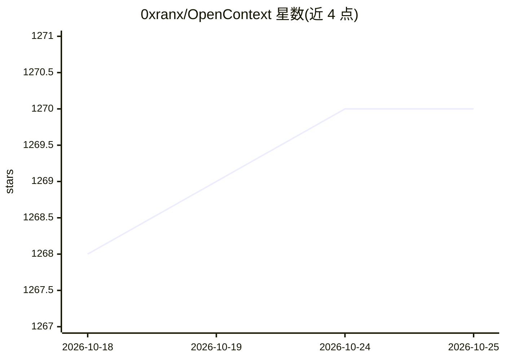

# 0xranx/OpenContext

⭐ 1,270 · JavaScript · MIT · 推送 2026-06-16 · [GitHub](https://github.com/0xranx/OpenContext) · [官网](https://0xranx.github.io/OpenContext/) · 个人维护 · 中文 README

**给编程 Agent 的个人上下文存储：跨项目持久记忆**

面向使用 Cursor/Claude Code/Codex/OpenCode 等编程代理的开发者的个人知识/上下文库：以 `oc` CLI 管理全局 contexts 目录（文件夹、文档、manifest、搜索），复用用户已有的编程代理 CLI 而非自带代理；提供 MCP Server 让代理以工具方式读写知识库，`oc init` 生成用户级 Skills 与斜杠命令，另有桌面应用与本地 Web UI 两种管理界面。npm 全局安装，MIT 许可。

## 筛选速览

| 维度 | 判定 | 备注 |
|---|---|---|
| AI 角色 | `ai-ecosystem` | LLM/agent 周边工具 |
| 许可风险 | `permissive` | MIT |
| 部署形态 | `library` | 以包/库形式分发 |
| 模型依赖 | — | README 未给出锁定关系 |
| 硬件要求 | — | 无带数字的原话,不猜 |
| 安装摩擦 | `low` | 无编译、无系统依赖或容器化 |
| 成熟度 | — | 结构信号不足 |

## 能力要点

- MCP Server 使 Cursor/Claude Code/Codex 等代理可调用 OpenContext 工具
- oc init 生成 Cursor/Claude Code/Codex 的用户级 Skills 与斜杠命令
- 全局 contexts 库跨仓库/会话共享，提供 manifest 与搜索命令
- 桌面应用 + 本地 Web UI 双图形界面

## 适用场景

- 让编程代理在多仓库、多会话间自动加载项目背景与决策记录
- 通过 MCP 把个人知识库接入 Cursor/Claude Code/Codex 工作流
- 用 GUI 或 CLI 管理、搜索、编辑供代理使用的上下文文档

## 场景标签

`知识库管理` `Agent 记忆` · 领域:Agent 开发

## 证据(README 行号)

> L27: OpenContext is a lightweight **personal context / knowledge store** for AI assistants (Agents) and coding tools lik
> L40: - **MCP Server** — so Cursor/Claude Code/Codex/Agents can call OpenContext as tools

## 星数曲线

2026-10-18 1,268 → 2026-10-25 1,270（+2）

---
*卡片 v1 · prompt 1.4 · 生成 2026-10-21 · 置信度 high · 依据 README sha `493d61166f16` · [字段定义](../../DATASET.md)*
