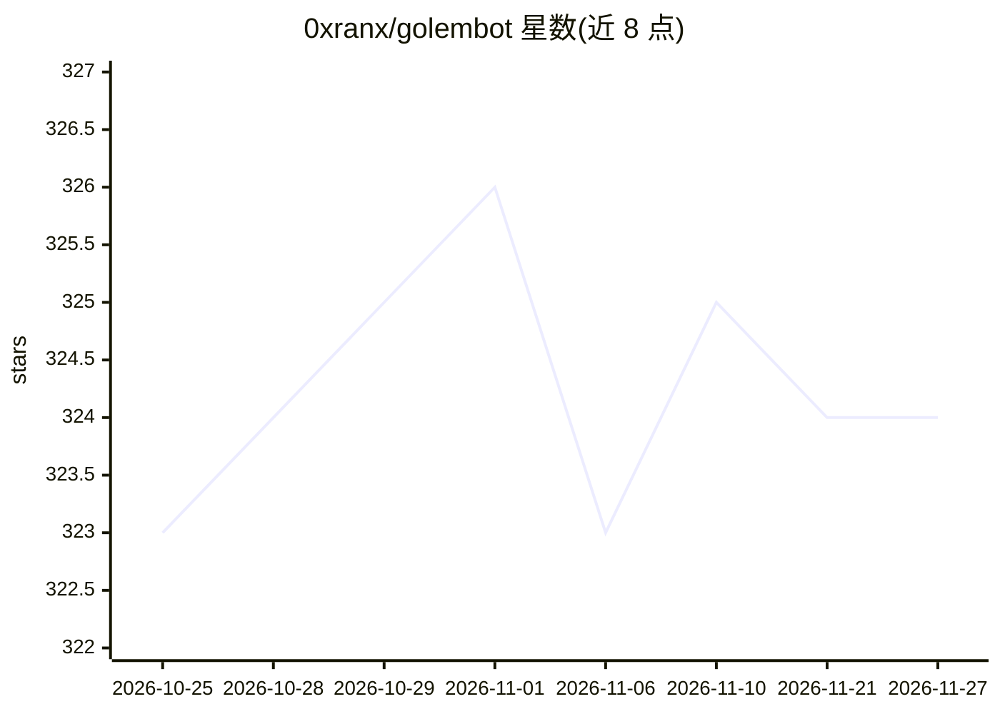

# 0xranx/golembot

⭐ 324 · TypeScript · MIT · 推送 2026-10-31 · [GitHub](https://github.com/0xranx/golembot) · [官网](https://0xranx.github.io/golembot/) · 个人维护 · 中文 README

**把 Coding Agent 接入 IM 渠道的网关，支持任意 LLM 提供商**

一个 Node.js CLI 与库，将 Cursor、Claude Code、OpenCode、Codex 等编码 Agent 通过单一配置接入 Slack、Telegram、Discord、飞书、钉钉、企业微信、微信及 HTTP 客户端，无需修改 Agent 代码。机制上提供统一 StreamEvent 接口实现引擎零成本切换、golem.yaml 单文件配置、SKILL.md 格式技能系统（兼容 ClawHub 13,000+ 社区技能）、内置 cron 定时任务、Web Dashboard 与多机 Fleet 聚合。支持 npm 全局安装与 Docker 部署。

## 筛选速览

| 维度 | 判定 | 备注 |
|---|---|---|
| AI 角色 | `ai-ecosystem` | LLM/agent 周边工具 |
| 许可风险 | `permissive` | MIT |
| 部署形态 | `self-host` | docker 或自建部署 |
| 模型依赖 | — | README 未给出锁定关系 |
| 硬件要求 | — | 无带数字的原话,不猜 |
| 安装摩擦 | `low` | 无编译、无系统依赖或容器化 |
| 成熟度 | — | 结构信号不足 |

## 能力要点

- 一条命令将 Coding Agent 接入 7 类 IM 渠道与 HTTP API
- 统一 StreamEvent 接口，4 种引擎切换零代码改动
- 兼容 ClawHub 13,000+ OpenClaw 社区技能，可搜索安装
- 内置 web Dashboard 与 Fleet 多实例聚合面板

## 适用场景

- 让团队在群聊里 @ 机器人完成写代码、分析文件等任务
- 把编码 Agent 嵌入自己的 Slack 机器人或 SaaS 产品
- 给 IM 机器人配置每日站会、依赖审计等定时推送任务
- 为客服或内部工具接入已有编码 Agent 而不重写框架

## 场景标签

`聊天机器人` `AI 助手` · 领域:对话与助手

## 证据(README 行号)

> L27: **GolemBot gives them a body.** One command connects your Coding Agent to Slack, Telegram, Discord, Feishu, DingTal
> L106: The `StreamEvent` interface is identical across all engines — switching requires zero code changes.

## 星数曲线

2026-10-25 323 → 2026-11-27 324（+1）

---
*卡片 v1 · prompt 1.4 · 生成 2026-11-25 · 置信度 high · 依据 README sha `45155198288a` · [字段定义](../../DATASET.md)*
