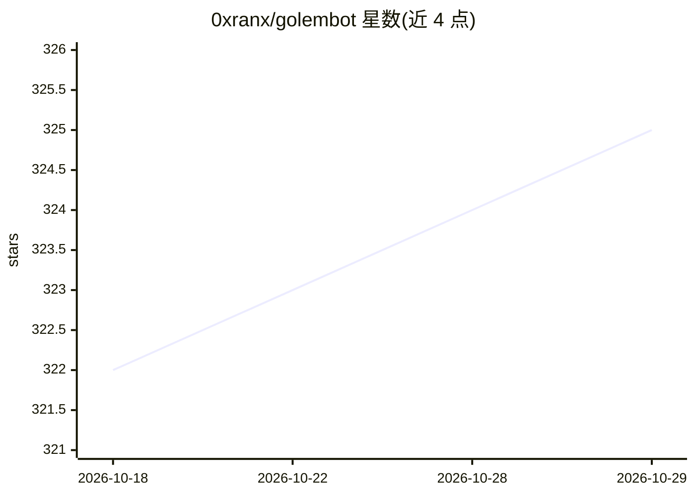

# 0xranx/golembot

⭐ 325 · TypeScript · MIT · 推送 2026-10-25 · [GitHub](https://github.com/0xranx/golembot) · [官网](https://0xranx.github.io/golembot/) · 个人维护 · 中文 README

**把 Coding Agent 接入 IM 渠道的网关与嵌入框架**

面向开发者的 Node.js 网关/SDK：用一条命令把 Cursor、Claude Code、OpenCode、Codex 等 CLI Coding Agent 接到 Slack、Telegram、Discord、飞书、钉钉、企业微信、微信等 7 个渠道或 HTTP API，也支持以 5 行代码嵌入自有产品。统一 StreamEvent 接口，切换引擎零代码改动；支持 OpenRouter、MiniMax、DeepSeek、SiliconFlow 等任意 provider 路由，兼容 ClawHub 13,000+ 社区技能，内置 cron 调度、Web Dashboard 与 Fleet 聚合面板。可自定义消息源适配器。注意 Codex 经自定义 provider 时要求该 provider 支持 OpenAI Responses API。

## 筛选速览

| 维度 | 判定 | 备注 |
|---|---|---|
| AI 角色 | `ai-ecosystem` | LLM/agent 周边工具 |
| 许可风险 | `permissive` | MIT |
| 部署形态 | `self-host` | docker 或自建部署 |
| 模型依赖 | — | README 未给出锁定关系 |
| 硬件要求 | — | 无带数字的原话,不猜 |
| 安装摩擦 | `low` | 无编译、无系统依赖或容器化 |
| 成熟度 | — | 结构信号不足 |

## 能力要点

- 一条命令将 4 种 Coding Agent 接入 7 个 IM 渠道或 HTTP
- 统一 StreamEvent 接口，切换引擎零代码改动
- 兼容 ClawHub 13,000+ SKILL.md 格式社区技能，支持 agent 自主搜索安装
- 内置 cron 定时任务、Web Dashboard 与 Fleet 多机器人聚合

## 适用场景

- 让团队在群聊中 @ 机器人调用 Claude Code/Codex 写代码、分析数据
- 把现有 Coding Agent 嵌入自家 Slack bot、内部工具或 SaaS 产品
- 通过一个配置块把 agent 路由到 DeepSeek、OpenRouter 等不同 provider
- 定时推送日报、依赖审计、测试报告到 IM

## 场景标签

`Agent 框架` · 领域:Agent 开发

## 证据(README 行号)

> L27: **GolemBot gives them a body.** One command connects your Coding Agent to Slack, Telegram, Discord, Feishu, DingTal
> L62: |**Provider freedom**|4 engines × any provider — OpenRouter, Requesty, MiniMax, DeepSeek, SiliconFlow. One config b

## 星数曲线

2026-10-18 322 → 2026-10-29 325（+3）

---
*卡片 v1 · prompt 1.4 · 生成 2026-10-21 · 置信度 high · 依据 README sha `2dd391a20a92` · [字段定义](../../DATASET.md)*
