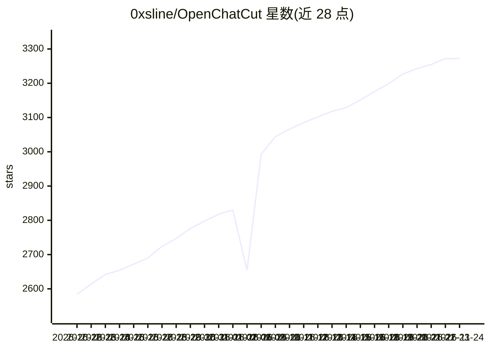

# 0xsline/OpenChatCut

⭐ 3,272 · TypeScript · AGPL-3.0 · 推送 2026-11-12 · [GitHub](https://github.com/0xsline/OpenChatCut) · [官网](https://openchatcut.com) · 个人维护 · 中文 README

**本地优先的对话式 AI 视频编辑器，代理直接写真实时间线**

基于 Electron/React/Remotion 的桌面视频编辑器，将多轨时间线编辑与对话式 Agent 结合：内置 Agent 与外部 MCP 客户端共享同一套编辑工具，编辑以提案形式写入可撤销的真实轨道、片段、转场、字幕与媒体，而非一次性生成不可改的视频。支持逐词转录驱动的文本剪辑、图像/视频/语音/音乐生成、WebGL 特效、LUT 与动态图形模板，导出 MP4、SRT、FCFPXML 及完整工程。采用 AGPL 许可，项目与媒体默认保留在本地，API key 保留在服务端。

## 筛选速览

| 维度 | 判定 | 备注 |
|---|---|---|
| AI 角色 | `ai-enhanced` | 去掉 AI 部分产品仍成立 |
| 许可风险 | `viral` | AGPL-3.0 |
| 部署形态 | `library` | 以包/库形式分发 |
| 模型依赖 | locked-api |  |
| 硬件要求 | — | 无带数字的原话,不猜 |
| 安装摩擦 | `medium` | 含编译或系统依赖之一 |
| 成熟度 | `idea` | |

## 能力要点

- 内置 Agent 与外部 MCP Agent 共享同一套编辑工具
- 编辑写入真实时间线轨道，可撤销、可版本化、可继续手动编辑
- 逐词转录驱动剪辑：文本删除口误/停顿，字幕自动避开人脸
- 导出 MP4、音频、SRT 字幕、FCPXML 与完整工程数据

## 适用场景

- 口播/访谈视频：转录后通过文本删除错误、停顿并自动生成字幕
- 让 Agent 完成粗剪、转场、配乐与节奏，再手动精修
- 为短视频平台重构画幅并生成标题、字幕、配音与音乐
- 开发者用 Codex/Claude Code 经 MCP 检查和修改真实工程

## 场景标签

 · 领域:视频创作/桌面工具

## 证据(README 行号)

> L45: OpenChatCut is an **open-source ChatCut alternative**: a video editor that brings **conversational agents** and **p
> L51: OpenChatCut is built for creators and developers who want AI to participate in the actual editing workflow without 
> L196: Only add the model or media-service credentials you actually use to `.env.local`. Features without configured thir

## 星数曲线

2026-10-22 2,584 → 2026-11-24 3,272（+688）

---
*卡片 v1 · prompt 1.4 · 生成 2026-11-23 · 置信度 high · 依据 README sha `410356306f30` · [字段定义](../../DATASET.md)*
