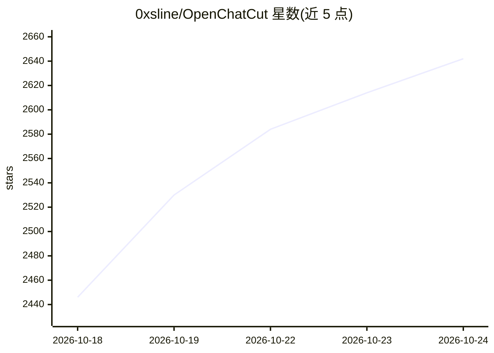

# 0xsline/OpenChatCut

⭐ 2,654 · TypeScript · AGPL-3.0 · 推送 2026-10-21 · [GitHub](https://github.com/0xsline/OpenChatCut) · [官网](https://openchatcut.com) · 个人维护 · 中文 README

**开源本地优先的对话式 AI 视频编辑器，Agent 可直接编辑真实时间线**

基于 TypeScript/React/Remotion/Electron 的开源视频编辑器，提供多轨道时间线、转场、LUT、WebGL 特效、字幕与转写编辑、动作图形模板及 MP4/FCPXML 等导出。AI 部分：内置对话 Agent 与外部 MCP 客户端（Codex、Claude Code）共享同一套编辑工具，以提案方式写入真实轨道并可撤销；支持图像/视频/语音/音乐生成任务。项目与媒体默认保存在本地，未配置第三方密钥时时间线编辑等本地功能仍可用。macOS 包未签名需手动批准，源码运行需 Node.js 24.x。

## 筛选速览

| 维度 | 判定 | 备注 |
|---|---|---|
| AI 角色 | `ai-enhanced` | 去掉 AI 部分产品仍成立 |
| 许可风险 | `viral` | AGPL-3.0 |
| 部署形态 | `library` | 以包/库形式分发 |
| 模型依赖 | locked-api |  |
| 硬件要求 | — | 无带数字的原话,不猜 |
| 安装摩擦 | `medium` | 含编译或系统依赖之一 |
| 成熟度 | `idea` | |

## 能力要点

- 内置 Agent 与 MCP 外部客户端共享同一套编辑工具，编辑可审查、可撤销
- 词级转写驱动的文本剪辑、自动字幕与说话人识别
- 多轨道时间线、WebGL 特效、LUT、动作图形模板与 FCPXML/MP4 导出
- 本地优先：项目与媒体保存在本机，API 密钥保留在服务端

## 适用场景

- 口播/访谈视频转写后按文本剪掉口误与停顿并自动生成字幕
- 用自然语言让 Agent 完成粗剪、转场、配乐与多格式成片
- 通过 MCP 让 Codex 或 Claude Code 检查并修改真实剪辑工程
- 制作短视频并经确认后一键发布到多个社交平台

## 场景标签

`语音识别` `图像视频处理` `视频生成` · 领域:内容生成

## 证据(README 行号)

> L43: OpenChatCut is an **open-source ChatCut alternative**: a video editor that brings **conversational agents** and **p
> L194: Only add the model or media-service credentials you actually use to `.env.local`. Features without configured thir

## 星数曲线

2026-10-18 2,446 → 2026-10-24 2,642（+196）

---
*卡片 v1 · prompt 1.4 · 生成 2026-10-21 · 置信度 high · 依据 README sha `465d06660b4a` · [字段定义](../../DATASET.md)*
