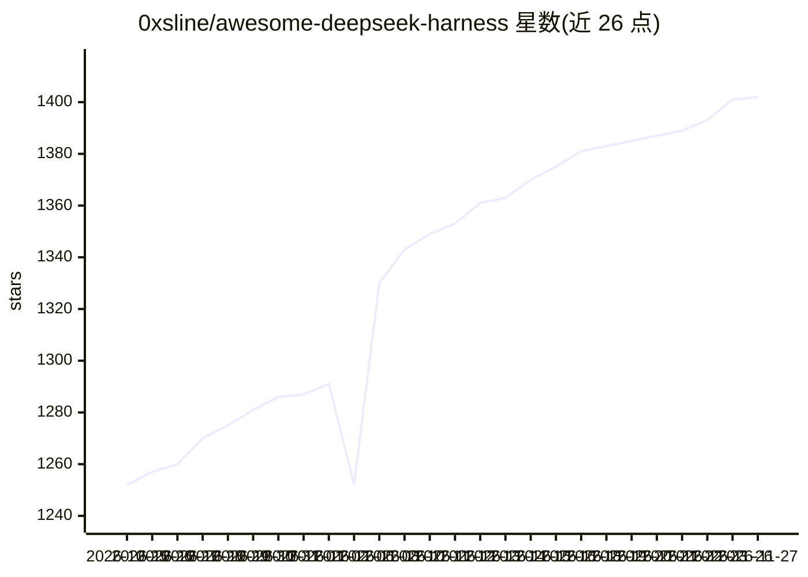

# 0xsline/awesome-deepseek-harness

⭐ 1,402 · Python · CC0-1.0 · 推送 2026-11-06 · [GitHub](https://github.com/0xsline/awesome-deepseek-harness) · [官网](https://deepseekdocs.com/) · 个人维护

**DeepSeek Harness (DSH) 插件与工具的策展清单**

面向 DeepSeek Harness (DSH) 生态的 curated 清单，条目来自 dsh-external/hub 目录与公开的 GitHub dsh-plugin 主题。内容覆盖安装方式、核心与 bundle 类插件（配置安装器、深度研究、工作流引擎、插件市场）、Agent 与编排类插件（多智能体协作、任务监督、双模型评测、子代理调度、自动恢复等）。部分 dsh-external 仓库链接仍需组织权限；插件仅当声明 dsh.bundle.patch 时才成为活动 profile 层。

## 筛选速览

| 维度 | 判定 | 备注 |
|---|---|---|
| AI 角色 | `ai-knowledge` | 知识聚合/清单类 |
| 许可风险 | `viral` | CC0-1.0 |
| 部署形态 | `library` | 以包/库形式分发 |
| 模型依赖 | — | README 未给出锁定关系 |
| 硬件要求 | — | 无带数字的原话,不猜 |
| 安装摩擦 | `low` | 无编译、无系统依赖或容器化 |
| 成熟度 | — | 结构信号不足 |

## 能力要点

- 条目来源为 dsh-external/hub 目录与公开 dsh-plugin 主题
- 提供 npx 安装官方运行时与 pnpm 驱动的插件包安装流程
- 覆盖多智能体编排、任务监督、双模型评测、会话恢复等插件类别
- 含从 Claude Code/Codex/Cursor 等 14 个平台迁移技能的工具

## 适用场景

- 为 DSH 查找可安装的插件与技能包
- 搭建多智能体协作或任务编排工作流
- 将其他 agent 平台的技能与配置迁移到 DSH

## 场景标签

`精选清单` · 领域:学习与行业

## 证据(README 行号)

> L4:  Awesome DeepSeek Harness
> L15:  Curated DeepSeek Harness (DSH) ecosystem: plugins, tools &amp; infrastructure. Sources: dsh-external/hub catalog a

## 星数曲线

2026-10-25 1,252 → 2026-11-27 1,402（+150）

---
*卡片 v1 · prompt 1.4 · 生成 2026-11-23 · 置信度 mid · 依据 README sha `21eb6ac7ff2e` · [字段定义](../../DATASET.md)*
