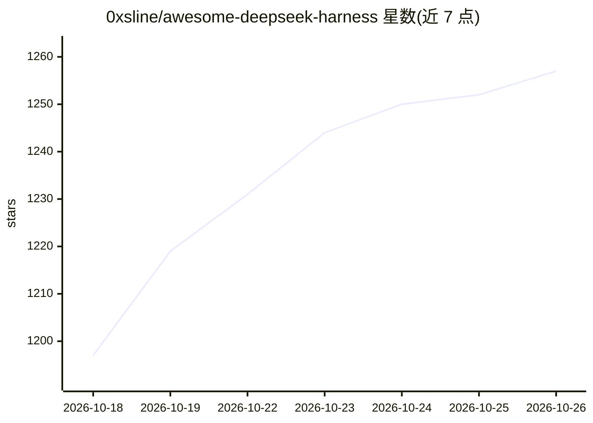

# 0xsline/awesome-deepseek-harness

⭐ 1,257 · Python · CC0-1.0 · 推送 2026-10-16 · [GitHub](https://github.com/0xsline/awesome-deepseek-harness) · [官网](https://deepseekdocs.com/) · 个人维护

**DeepSeek Harness 插件与生态工具的策展清单**

面向 DeepSeek Harness（DSH）编码代理运行时的 awesome 类生态清单：条目来源于 dsh-external/hub 目录与公开 dsh-plugin topic，收录插件、工具与基础设施，按 Core & Bundles、Agents & Orchestration 等类别组织。条目覆盖插件市场、多智能体编排、任务调度、会话迁移、模型评测与自进化引擎等。清单页同时给出官方运行时安装方式（npx @deepseek-ai/dsh）与通过 pnpm 安装外部 profile bundle 的命令；部分 dsh-external 仓库链接可能需要组织权限访问。

## 筛选速览

| 维度 | 判定 | 备注 |
|---|---|---|
| AI 角色 | `ai-knowledge` | 知识聚合/清单类 |
| 许可风险 | `viral` | CC0-1.0 |
| 部署形态 | `library` | 以包/库形式分发 |
| 模型依赖 | locked-api |  |
| 硬件要求 | — | 无带数字的原话,不猜 |
| 安装摩擦 | `low` | 无编译、无系统依赖或容器化 |
| 成熟度 | — | 结构信号不足 |

## 能力要点

- 条目来自 dsh-external/hub 目录与公开 GitHub dsh-plugin topic 两个来源
- 收录插件市场、多智能体编排、任务调度、迁移向导等类别的生态项目
- 给出官方运行时（npx）与 profile bundle（dsh plugin）两种安装途径

## 适用场景

- 为 DeepSeek Harness 查找可安装的插件与工具
- 了解 DSH 生态中多智能体编排与工作流类项目的分布
- 寻找从 Claude Code、Cursor 等平台迁移配置到 DSH 的工具

## 场景标签

`精选清单` · 领域:学习与行业

## 证据(README 行号)

> L15:  Curated DeepSeek Harness (DSH) ecosystem: plugins, tools &amp; infrastructure. Sources: dsh-external/hub catalog a
> L6: # Awesome DeepSeek Harness Awesome

## 星数曲线

2026-10-18 1,197 → 2026-10-26 1,257（+60）

---
*卡片 v1 · prompt 1.4 · 生成 2026-10-21 · 置信度 mid · 依据 README sha `3798903f9440` · [字段定义](../../DATASET.md)*
