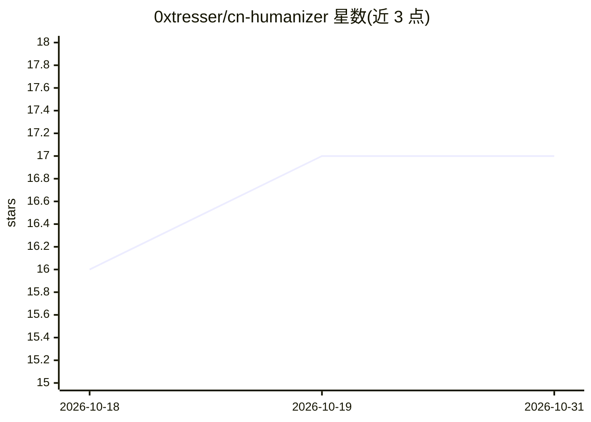

# 0xtresser/cn-humanizer

⭐ 17 · Shell · 推送 2026-03-10 · [GitHub](https://github.com/0xtresser/cn-humanizer) · 个人维护 · 中文 README

**去除中文 AI 写作痕迹、翻译去腔的 Agent Skill**

面向 AI 编码工具（Claude Code、OpenCode、Cursor 等）的 agent skill，以纯 Markdown 规则文件形式提供两种能力：把 AI 生成的中文改写为口语化表达，以及在英译中时直接输出避免翻译腔的译文。规则覆盖 18 种中文 AI 写作模式、100+ 高频 AI 词汇和 12 种翻译腔修正规则。零依赖，通过一键安装脚本或 git clone 到 skill 目录即可使用。

## 筛选速览

| 维度 | 判定 | 备注 |
|---|---|---|
| AI 角色 | `ai-ecosystem` | LLM/agent 周边工具 |
| 许可风险 | `none` | — |
| 部署形态 | `None` |  |
| 模型依赖 | — | README 未给出锁定关系 |
| 硬件要求 | — | 无带数字的原话,不猜 |
| 安装摩擦 | `low` | 无编译、无系统依赖或容器化 |
| 成熟度 | — | 结构信号不足 |

## 能力要点

- 识别 18 种中文 AI 写作模式，覆盖 100+ 高频 AI 词汇
- 12 种翻译腔修正规则，翻译时直接输出非翻译体中文
- 纯 Markdown 文件零依赖，支持 Claude Code/OpenCode/Cursor 等 skill 目录

## 适用场景

- 让我的 AI 编码工具把生成的中文文案改得更口语化
- 英文技术文章翻译成中文时避免翻译腔
- 给 agent 装一个中文润色/去 AI 味技能

## 场景标签

`AI 写作` `提示工程` · 领域:Agent 开发

## 证据(README 行号)

> L5: 一个 agent skill，干两件事：
> L47: 脚本会自动检测你的环境（Claude Code 或 OpenCode），把 skill 安装到对应目录。没有任何依赖——纯 Markdown 文件，不需要 npm、pip 或其他包管理器。
> L159: 纯 Markdown 文件，零依赖。能读 `.md` 文件的 AI 编码环境都能用。

## 星数曲线

2026-10-18 16 → 2026-10-31 17（+1）

---
*卡片 v1 · prompt 1.4 · 生成 2026-10-30 · 置信度 high · 依据 README sha `16a096e3b3a5` · [字段定义](../../DATASET.md)*
