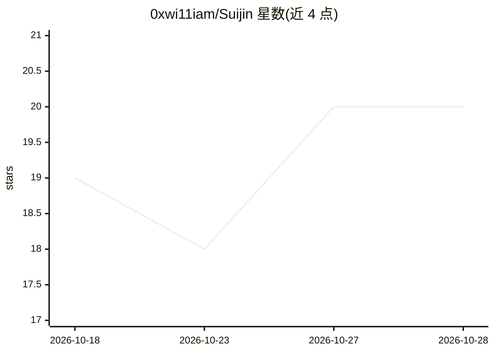

# 0xwi11iam/Suijin

⭐ 20 · Python · AGPL-3.0 · 推送 2026-10-27 · [GitHub](https://github.com/0xwi11iam/Suijin) · 个人维护

**面向渗透测试者的全自主 Web 渗透/红队 agent 框架**

基于 LangGraph 的开源 Web 应用渗透测试与红队框架，面向漏洞赏金猎人、渗透测试团队、CTF 选手与安全研究者。用户指定测试目标后，系统映射攻击面、按漏洞类派出专项子 agent（IDOR、注入、SSRF、认证等 9 类）、多 agent 会话协作共享发现，验证方式为运行 POC 并要求目标产生预期标记，未命中则携带命令与输出返回；另有观测引擎从累积证据中确定性检测 IDOR 与访问控制缺陷。提供操作台（operator console）、跨任务记忆、内置实验靶场（15 个服务、100+ 漏洞实例、22 个 flag）以及隔离运行的容器 Box（Docker/OrbStack 引擎）。仅限授权测试使用，AGPL v3.0 许可，作者声明项目仍在活跃开发中。

## 筛选速览

| 维度 | 判定 | 备注 |
|---|---|---|
| AI 角色 | `ai-native` | 本体是模型或模型工具 |
| 许可风险 | `viral` | AGPL-3.0 |
| 部署形态 | `None` |  |
| 模型依赖 | — | README 未给出锁定关系 |
| 硬件要求 | — | 无带数字的原话,不猜 |
| 安装摩擦 | `low` | 无编译、无系统依赖或容器化 |
| 成熟度 | `idea` | |

## 能力要点

- POC 先行验证：每个发现须运行漏洞利用并产出目标标记方可确认
- 按漏洞类分派的 9 类专项子 agent 与多会话 mesh 协作
- 确定性观测引擎从累积证据检测 IDOR 与访问控制缺陷
- suijin box 一键构建含 40+ 工具的 Kali 容器，宿主机不受影响

## 适用场景

- 漏洞赏金：载入项目规则后对范围内目标跑全流程并取回已验证发现
- 授权渗透测试中多 agent 分工同一目标并共享死胡同与成果
- CTF 中切换 profile 以夺旗为目标调整策略
- 在自带实验靶场上练习或对 agent 改动做基准评分

## 场景标签

`Agent 框架` `多智能体` `网络安全` · 领域:Agent 开发

## 证据(README 行号)

> L5:  Your team of fully autonomous web app pentesters and red teamers for any situation.
> L35: You tell it what to test. It maps the product landscape, spawns the right
> L38: and *gets hacking*. It runs the engagement — recon, exploitation,

## 星数曲线

2026-10-18 19 → 2026-10-28 20（+1）

---
*卡片 v1 · prompt 1.4 · 生成 2026-10-28 · 置信度 high · 依据 README sha `f52fff6f9352` · [字段定义](../../DATASET.md)*
