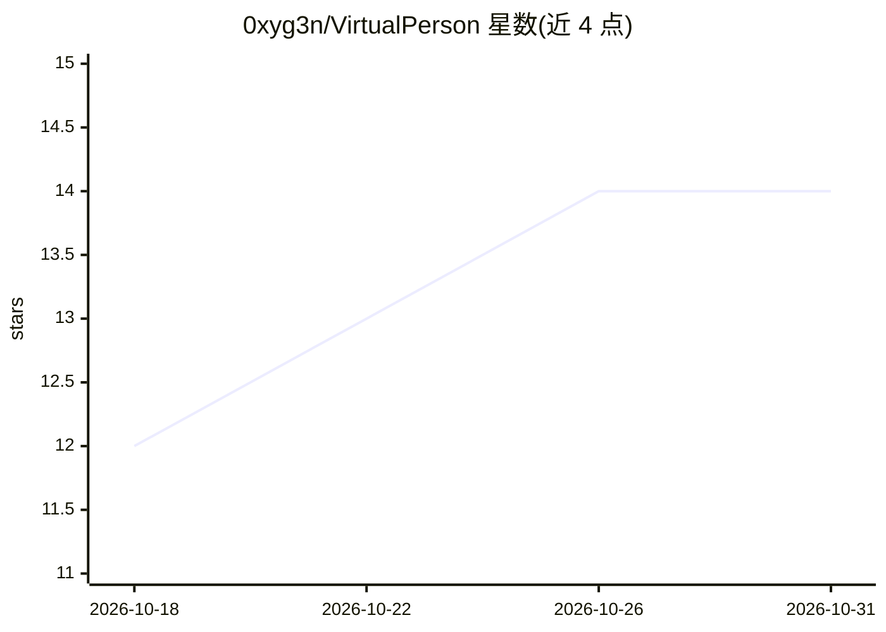

# 0xyg3n/VirtualPerson

⭐ 14 · Shell · AGPL-3.0 · 推送 2026-04-13 · [GitHub](https://github.com/0xyg3n/VirtualPerson) · [官网](https://github.com/0xyg3n/VirtualPerson) · 个人维护

**为 AI agent 提供经 Mullvad VPN 路由的 Chrome 运行环境**

在无头 Linux 服务器上运行完整 Google Chrome（虚拟显示 + VNC 监控），全部流量经 Mullvad VPN SOCKS5/WireGuard 出口。提供两条控制通路：AutoHook 扩展（WebSocket 桥接 chrome.debugger，端口 18792）与直连 CDP（127.0.0.1:9222），已在 Hermes Agent 与 OpenClaw 上测试。所有服务仅绑定本机回环，访问须经 SSH 隧道；含反自动化检测标志、看门狗自动重启与 dumb-init 僵尸进程回收。支持 Docker 与裸机两种部署。

## 筛选速览

| 维度 | 判定 | 备注 |
|---|---|---|
| AI 角色 | `ai-ecosystem` | LLM/agent 周边工具 |
| 许可风险 | `viral` | AGPL-3.0 |
| 部署形态 | `self-host` | docker 或自建部署 |
| 模型依赖 | — | README 未给出锁定关系 |
| 硬件要求 | — | 无带数字的原话,不猜 |
| 安装摩擦 | `low` | 无编译、无系统依赖或容器化 |
| 成熟度 | — | 结构信号不足 |

## 能力要点

- AutoHook 扩展与直连 CDP 两条浏览器控制通路
- 全部 Chrome 流量经 Mullvad VPN（SOCKS5/WireGuard），WebRTC 防泄漏
- VNC/noVNC 经 SSH 隧道做人工监控
- Chrome 看门狗每 30 秒检查 CDP 并自动恢复崩溃

## 适用场景

- 给 Hermes Agent / OpenClaw 等代理提供可操控的真实浏览器
- 为虚拟人设账号管理提供持久化 Chrome 档案（cookies/会话跨重启保留）
- 需要浏览器操作全程走 VPN 出口的自动化场景

## 场景标签

`浏览器自动化` · 领域:效率与自动化

## 证据(README 行号)

> L11: Secure, VPN-routed Chrome environment for managing virtual personas on headless Linux servers. Built for AI agent o
> L15: VirtualPerson gives your AI agent a real browser. Not a headless stub or a Playwright-managed Chromium, but a full 
> L129: Hermes Agent is installed automatically in the Docker image. The gateway starts after the display stack is ready.

## 星数曲线

2026-10-18 12 → 2026-10-31 14（+2）

---
*卡片 v1 · prompt 1.4 · 生成 2026-10-31 · 置信度 high · 依据 README sha `83ecb7248b74` · [字段定义](../../DATASET.md)*
