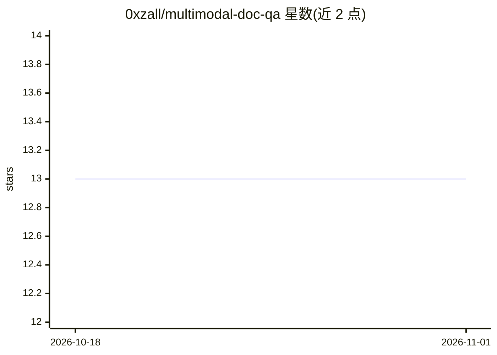

# 0xzall/multimodal-doc-qa

⭐ 13 · Python · NOASSERTION · 推送 2026-06-03 · [GitHub](https://github.com/0xzall/multimodal-doc-qa) · 个人维护

**个人研究项目：视觉语言模型+检索对含图表PDF做多模态问答**

个人研究项目，探索多模态文档理解：用 LLaVA-1.6（Mistral-7B 变体）作为视觉语言骨干，LlamaIndex 做文本侧检索，LangChain 做编排，pdf2image + tesseract 做页面渲染与回退 OCR，对包含图表、表格与复杂版式的 PDF 问答。处于第 6 周：基线检索可用，VLM 评测管线可端到端运行，图定位回答仍有质量问题，过程记录在 RESEARCH-LOG.md。作者在单张 24GB 消费级 GPU 上跑实验，计划申请 AMD Developer Cloud 的 MI250/MI300X 资源。MIT 许可。README 未给出安装命令。

## 筛选速览

| 维度 | 判定 | 备注 |
|---|---|---|
| AI 角色 | `ai-native` | 本体是模型或模型工具 |
| 许可风险 | `none` | NOASSERTION |
| 部署形态 | `None` |  |
| 模型依赖 | — | README 未给出锁定关系 |
| 硬件要求 | — | 无带数字的原话,不猜 |
| 安装摩擦 | `medium` | 含编译或系统依赖之一 |
| 成熟度 | `idea` | |

## 能力要点

- LLaVA-1.6 视觉语言骨干 + LlamaIndex 文本检索的双模态查询架构
- pdf2image 页面渲染与 tesseract 回退 OCR
- 作者自称早期研究阶段，详细状态见 RESEARCH-LOG.md

## 适用场景

- 对含图表与复杂版式的技术 PDF 做问答实验
- 参考其多模态 RAG 管线与消融实验设计
- 关注 ROCm/CUDA 吞吐对比研究

## 场景标签

`文档问答` `RAG` `多模态` · 领域:知识与检索

## 证据(README 行号)

> L3: > A personal research project exploring multimodal document understanding — combining
> L29: - `LLaVA-1.6` (Mistral-7B variant) — vision-language backbone

## 星数曲线

2026-10-18 13 → 2026-11-01 13（+0）

---
*卡片 v1 · prompt 1.4 · 生成 2026-11-01 · 置信度 mid · 依据 README sha `6869f183215b` · [字段定义](../../DATASET.md)*
