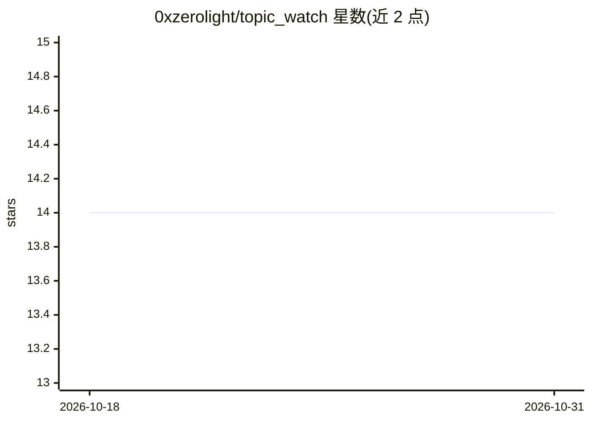

# 0xzerolight/topic_watch

⭐ 14 · Python · GPL-3.0 · 推送 2026-10-30 · [GitHub](https://github.com/0xzerolight/topic_watch) · 个人维护

**自托管新闻监控：仅在有真正新信息时通知用户**

自托管的主题新闻监控服务：按用户定义的主题定时抓取 RSS/Bing News/Google News（可选 Exa 语义搜索）文章，与滚动维护的主题知识基线（knowledge state）对比，由 LLM 判定是否出现真正新信息，仅新信息触发带摘要和来源的通知。LLM 接入通过 LiteLLM，支持 OpenAI/Anthropic/Gemini/Groq/Ollama 等多种提供方（BYOK），通知经 Apprise 覆盖 100+ 服务。以 Docker 预构建镜像或一键脚本安装，也可用 Python 3.11+ 源码运行；无内置登录认证，默认仅绑定 127.0.0.1，面向单用户。

## 筛选速览

| 维度 | 判定 | 备注 |
|---|---|---|
| AI 角色 | `ai-native` | 本体是模型或模型工具 |
| 许可风险 | `viral` | GPL-3.0 |
| 部署形态 | `self-host` | docker 或自建部署 |
| 模型依赖 | local-ok | 支持本地模型 |
| 硬件要求 | — | 无带数字的原话,不猜 |
| 安装摩擦 | `low` | 无编译、无系统依赖或容器化 |
| 成熟度 | — | 结构信号不足 |

## 能力要点

- LLM 新颖性判定：与主题知识基线对比，仅新信息触发通知
- 经 LiteLLM 支持任意 LLM 提供方，可本地 Ollama 运行
- 100+ 通知服务（Apprise）：Discord/Slack/Telegram/email 等
- 知识状态修订历史与 diff 时间线、重要度 1-5 评分

## 适用场景

- 盯踪特定主题的新闻，只收到真正的新进展而非重复报道
- 自托管私有的新闻监控，数据存本地 SQLite
- 把新信息推送到 Discord/Telegram/ntfy 等通知渠道

## 场景标签

 · 领域:新闻监控/信息聚合

## 证据(README 行号)

> L132: 3. An LLM decides if anything is actually new.
> L9: Self-hosted news monitor that only notifies on genuinely new info.

## 星数曲线

2026-10-18 14 → 2026-10-31 14（+0）

---
*卡片 v1 · prompt 1.4 · 生成 2026-10-31 · 置信度 high · 依据 README sha `8ab24b60245b` · [字段定义](../../DATASET.md)*
