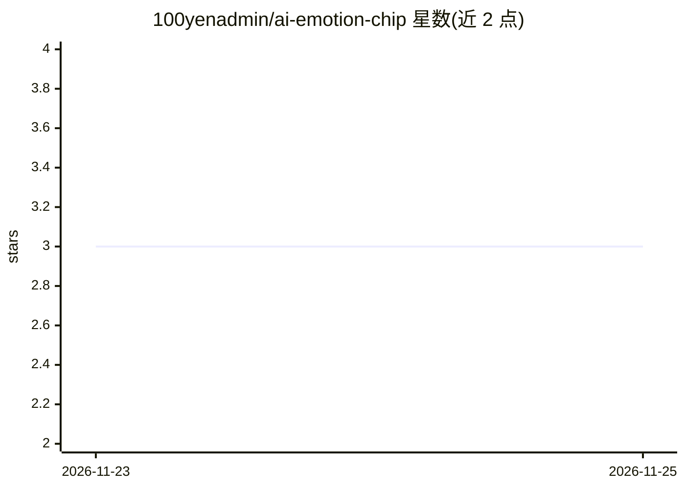

# 100yenadmin/ai-emotion-chip

⭐ 3 · Python · Apache-2.0 · 推送 2026-11-21 · [GitHub](https://github.com/100yenadmin/ai-emotion-chip) · 个人维护

**给 Hermes agent 生成语气标记并由 TTS 配音的插件**

Hermes Agent 插件：让 agent 在要朗读的文本中自行写入语气标记（如 [sigh]、[whisper]、[pause]），插件按 ElevenLabs v4 与 Fish Audio（s2.1-pro/Drama 3）各自的方言与参数上限渲染这些标记，再交由语音服务朗读。需 Hermes 0.22.2+，默认配合 Fish Audio 插件登录，或使用 ElevenLabs API key。插件不新增 agent 未写出的情绪，也不测量情绪；本地仅存标记与参数日志（约 10MB 上限），无遥测。仓库另含 CC0 情绪概念数据、预注册评估设计与基准工具。

## 筛选速览

| 维度 | 判定 | 备注 |
|---|---|---|
| AI 角色 | `ai-ecosystem` | LLM/agent 周边工具 |
| 许可风险 | `permissive` | Apache-2.0 |
| 部署形态 | `None` |  |
| 模型依赖 | — | README 未给出锁定关系 |
| 硬件要求 | — | 无带数字的原话,不猜 |
| 安装摩擦 | `low` | 无编译、无系统依赖或容器化 |
| 成熟度 | — | 结构信号不足 |

## 能力要点

- agent 自写 [sigh]/[whisper]/[pause] 等语气标记，插件按两家 TTS 方言渲染
- 支持 ElevenLabs v4 与 Fish Audio（s2.1-pro 和 Drama 3）两种语音后端
- 提供 /chip status、/chip why 等命令检查渲染与配置
- 包含 171 个情绪概念的 CC0 数据与预注册评估流程

## 适用场景

- 让 Hermes agent 的语音回复带有叹气、耳语、停顿等表达方式
- 在 ElevenLabs 与 Fish Audio 之间切换语音后端
- 对比手写语气标记与插件渲染的输出差异

## 场景标签

`语音合成` · 领域:内容生成

## 证据(README 行号)

> L57: Hermes Emotion Chip is a Hermes Agent plugin. The agent writes its
> L13: Hermes 0.22.2 or newer

## 星数曲线

2026-11-23 3 → 2026-11-25 3（+0）

---
*卡片 v1 · prompt 1.4 · 生成 2026-11-23 · 置信度 high · 依据 README sha `eb1d21f2d06c` · [字段定义](../../DATASET.md)*
