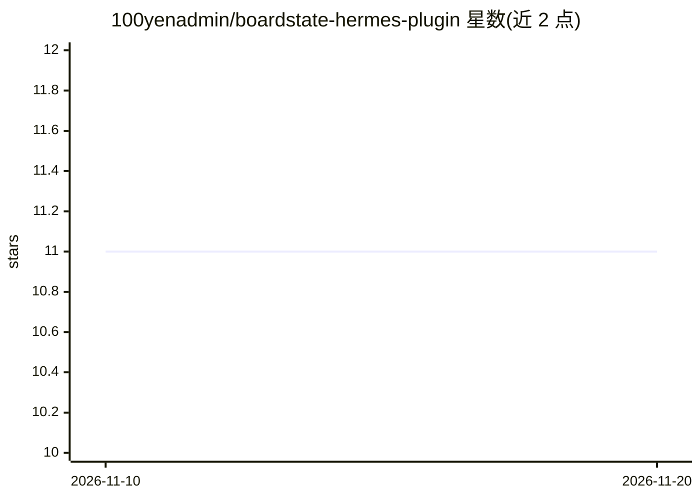

# 100yenadmin/boardstate-hermes-plugin

⭐ 11 · JavaScript · MIT · 推送 2026-11-18 · [GitHub](https://github.com/100yenadmin/boardstate-hermes-plugin) · 个人维护

**Hermes agent 的看板插件：一句指令生成并持续维护 KPI 看板**

面向 Hermes agent 平台的插件：用户发出一条指令后，agent 调用 19 个 `boardstate_*` 原生工具，在 Web dashboard 的 Board 标签页与 Desktop 的 Board 页面生成包含 KPI 卡片、表格、图表、笔记、风险列表与实时 Hermes 数据的面板，并随计划变更原地更新。看板以校验过的文档形式保存在 Hermes home，支持撤销、历史、导入导出，重启后保留。需 Hermes 0.21.2+ 与 Node.js 20+，无需 API key；外部连接器默认关闭，读取需审批、变更操作等待运营者决定。

## 筛选速览

| 维度 | 判定 | 备注 |
|---|---|---|
| AI 角色 | `ai-native` | 本体是模型或模型工具 |
| 许可风险 | `permissive` | MIT |
| 部署形态 | `None` |  |
| 模型依赖 | — | README 未给出锁定关系 |
| 硬件要求 | — | 无带数字的原话,不猜 |
| 安装摩擦 | `low` | 无编译、无系统依赖或容器化 |
| 成熟度 | — | 结构信号不足 |

## 能力要点

- 19 个原生 agent 工具（boardstate_*）构建与更新看板组件
- 组件类型含 KPI 卡片、表格、图表、markdown、实时 Hermes 会话/用量数据与审批
- 看板为可校验文档，支持撤销、历史、导入导出，跨重启保留
- 默认零第三方网络请求，外部连接器为 opt-in 且需运营者授权

## 适用场景

- 让 agent 在对话中生成项目启动看板（KPI、任务表、预算图）
- 计划变更时让 agent 原地更新看板数据
- 监控 Hermes agent 自身的会话、用量与 cron 任务

## 场景标签

 · 领域:AI agent 工具/仪表板

## 证据(README 行号)

> L5: From one ask, your Hermes agent builds a live board of KPIs, tables and charts, and keeps it current as plans change
> L60:  19 native agent tools (`boardstate_*`). An optional MCP endpoint is there for other clients.
> L25: More install options). You need Hermes 0.21.2 or newer and Node.js 20 or newer.

## 星数曲线

2026-11-10 11 → 2026-11-20 11（+0）

---
*卡片 v1 · prompt 1.4 · 生成 2026-11-19 · 置信度 mid · 依据 README sha `e3d478273672` · [字段定义](../../DATASET.md)*
