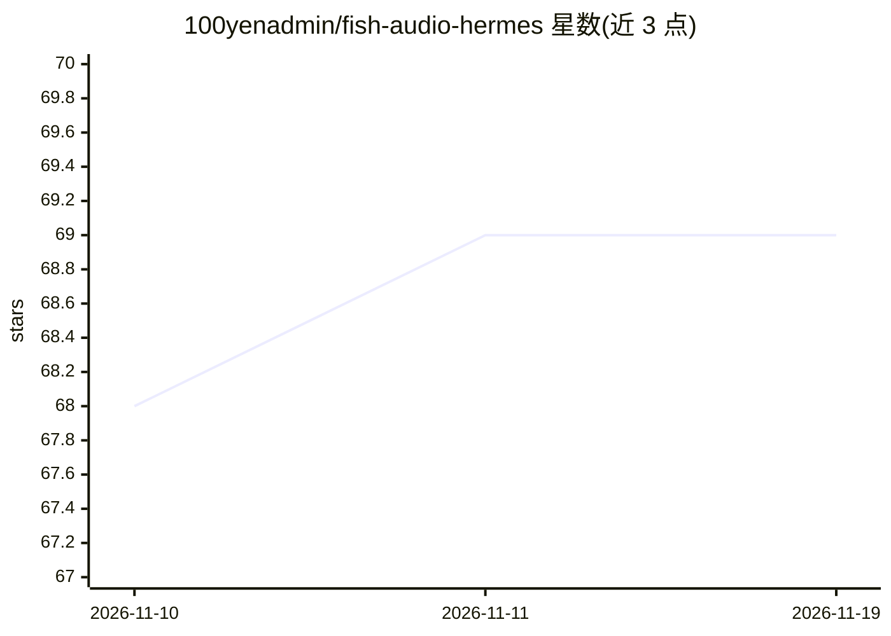

# 100yenadmin/fish-audio-hermes

⭐ 69 · Python · Apache-2.0 · 推送 2026-11-18 · [GitHub](https://github.com/100yenadmin/fish-audio-hermes) · [官网](https://fish.audio) · 组织维护 · 中文 README

**给 Hermes Agent 接入 Fish Audio 的语音/转录插件**

Electric Sheep 维护的 Hermes Agent 官方 Fish Audio 插件，在 Hermes CLI、各消息应用与桌面端运行：接入 Fish Audio S2/Drama 3 模型提供 80+ 语言表达性语音合成、语音克隆与设计、社区语音库检索，STT 覆盖语音笔记（transcribe-1-pro）、实时听写与带说话人/时间戳/SRT 的富转录。通过 /fish 命令集与 fish_speak 等模型工具暴露能力，克隆/删除操作经 Hermes 审批门。需 Fish Audio API key，合成与转录为计费请求；不支持自定义词汇表。

## 筛选速览

| 维度 | 判定 | 备注 |
|---|---|---|
| AI 角色 | `ai-ecosystem` | LLM/agent 周边工具 |
| 许可风险 | `permissive` | Apache-2.0 |
| 部署形态 | `None` |  |
| 模型依赖 | — | README 未给出锁定关系 |
| 硬件要求 | — | 无带数字的原话,不猜 |
| 安装摩擦 | `low` | 无编译、无系统依赖或容器化 |
| 成熟度 | — | 结构信号不足 |

## 能力要点

- 表达性语音合成：情感标签、多说话人对话、自定义发音词典
- 语音克隆与文字描述生成声音，经审批门确认
- STT 三通道：语音笔记、实时逐字听写、带说话人与 SRT 的转录
- 提供 fish_speak/fish_transcribe 等脚本化 CLI 与 JSON 输出

## 适用场景

- 让 Hermes Agent 用语音回复并朗读内容
- 为客服或陪伴类 agent 设计并固定专属声音
- 会议录音转写并生成带说话人的字幕
- 定时语音播报（配合 Hermes cron）

## 场景标签

`语音合成` `语音识别` · 领域:内容生成

## 证据(README 行号)

> L7: The official Fish Audio plugin for Hermes Agent,
> L54: Audio the speech and transcription provider where none is set, and replaces another provider only if you confirm
> L139: Plain read-aloud uses Hermes's own `text_to_speech` tool, with Fish Audio as the provider. Include the

## 星数曲线

2026-11-10 68 → 2026-11-19 69（+1）

---
*卡片 v1 · prompt 1.4 · 生成 2026-11-18 · 置信度 high · 依据 README sha `632bc63d8868` · [字段定义](../../DATASET.md)*
