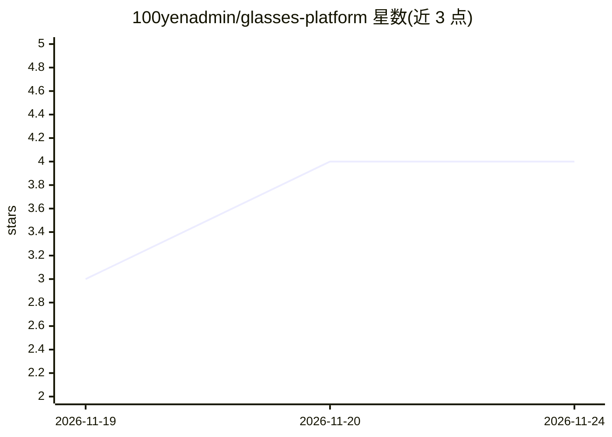

# 100yenadmin/glasses-platform

⭐ 4 · Python · MIT · 推送 2026-11-21 · [GitHub](https://github.com/100yenadmin/glasses-platform) · 个人维护 · 中文 README

**把 Hermes agent 接入智能眼镜与语音设备的网关平台插件**

一个 Hermes Agent 的 gateway platform plugin，把智能眼镜、手表、语音盒子等可穿戴设备作为 agent 的对话渠道接入，方式与 Hermes 接入 Telegram/Slack 相同。设备经单一 WebSocket 或 HTTP 路由连接网关；拍照提问依赖具备视觉能力的模型，语音应答由 Hermes 自带的 speech-to-text 与 text-to-speech 处理；agent 的危险命令审批可通过语音或按钮完成。目前为 v0.6.11 预览版，Hermes 侧已在模拟器与真实网关上验证，但尚未在真实眼镜等硬件上测试；监听默认不加密并绑定所有接口，需自行配置 Tailscale 或 TLS 反代。

## 筛选速览

| 维度 | 判定 | 备注 |
|---|---|---|
| AI 角色 | `ai-ecosystem` | LLM/agent 周边工具 |
| 许可风险 | `permissive` | MIT |
| 部署形态 | `library` | 以包/库形式分发 |
| 模型依赖 | — | README 未给出锁定关系 |
| 硬件要求 | — | 无带数字的原话,不猜 |
| 安装摩擦 | `medium` | 含编译或系统依赖之一 |
| 成熟度 | `idea` | |

## 能力要点

- 一条命令安装并配对设备：hermes plugins install + hermes glasses pair，输出连接 URL 与二维码
- 支持多类设备：Even Realities G2、ESP32 xiaozhi 语音盒子（138+ 板）、Omi 挂坠、Pebble、Apple Watch/Siri 快捷指令（HTTP /turn、/pending）
- 语音审批 agent 的危险命令，推送提醒在设备重连后送达
- 同一用户的多设备共享一个 Hermes 会话（记忆、计划任务、工具一致）

## 适用场景

- 戴眼镜时拍照问 agent "我在看什么"
- 用手表或语音盒子远程向 agent 提问并接收提醒推送
- 不方便打字时用语音回答 agent 的命令审批请求

## 场景标签

`语音 Agent` · 领域:对话与助手

## 证据(README 行号)

> L59: A Hermes Agent **gateway platform plugin** that adds smart glasses as a
> L62: - A thin companion app on your phone (or the glasses' own app platform) connects over one WebSocket.

## 星数曲线

2026-11-19 3 → 2026-11-24 4（+1）

---
*卡片 v1 · prompt 1.4 · 生成 2026-11-21 · 置信度 mid · 依据 README sha `1c5f6f74c446` · [字段定义](../../DATASET.md)*
