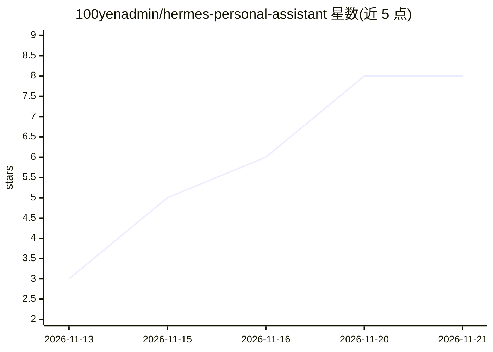

# 100yenadmin/hermes-personal-assistant

⭐ 8 · Python · Apache-2.0 · 推送 2026-11-19 · [GitHub](https://github.com/100yenadmin/hermes-personal-assistant) · 个人维护

**Hermes agent 的个人事务插件：代填表单、停在最后一步等你确认**

面向 Hermes agent 平台的插件，将日常事务（订餐、行程、收件箱、日历、家务、购物、旅行）交给 agent 在真实网站上执行：搜索页面、填写字段，并在最终提交按钮前停下，向用户展示包含地点、时间、价格、取消条款与证据的审批包。核心机制包括持久化上下文、可重放的安全动作、工作流对账、精确动作授权与可选证据投递；数据存于 Hermes profile 内的 SQLite 账本。README 声明尚未在真实账户上完成过一次实际预订，电话功能为回环模拟。

## 筛选速览

| 维度 | 判定 | 备注 |
|---|---|---|
| AI 角色 | `ai-native` | 本体是模型或模型工具 |
| 许可风险 | `permissive` | Apache-2.0 |
| 部署形态 | `desktop` | 安装包/桌面程序 |
| 模型依赖 | — | README 未给出锁定关系 |
| 硬件要求 | — | 无带数字的原话,不猜 |
| 安装摩擦 | `low` | 无编译、无系统依赖或容器化 |
| 成熟度 | `idea` | |

## 能力要点

- 在真实站点填写到最后一页并停止，输出审批包后由用户确认
- 精确动作授权：工作流将单个工具调用绑定到完整参数与受信运行时身份
- SQLite 持久账本保存动作、收据、来源修订与对账状态
- 通过 hermes plugins install 一行命令安装，无需 API key 即可启动

## 适用场景

- 让 agent 帮我在真实网站预订餐厅或填写表单，最后一步由我确认
- 管理日历、收件箱跟进与家庭事务的跨会话待办
- 出行前集中管理行程事实与准备动作

## 场景标签

`AI 助手` `浏览器自动化` · 领域:效率与自动化

## 证据(README 行号)

> L5: Your Hermes agent runs errands on the real sites, fills every field, and stops at the last button until you say yes.
> L27: 3. **See the prepared result.** PA searches the real site, fills every field, and stops at the final button. It sho
> L56: - **Exact-action authorization:** an explicitly scoped PA workflow can bind one

## 星数曲线

2026-11-13 3 → 2026-11-21 8（+5）

---
*卡片 v1 · prompt 1.4 · 生成 2026-11-20 · 置信度 high · 依据 README sha `6c7edd0ac1ca` · [字段定义](../../DATASET.md)*
