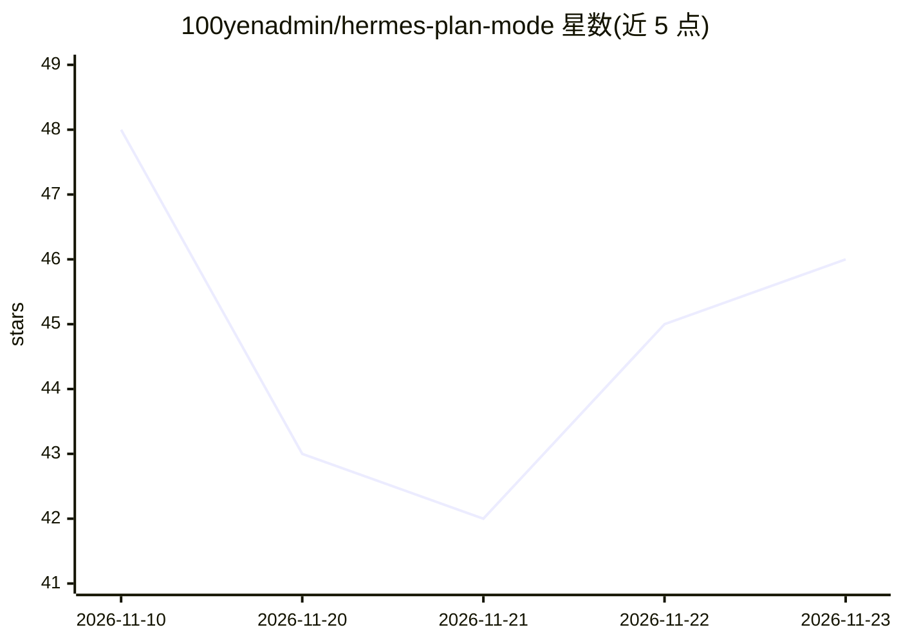

# 100yenadmin/hermes-plan-mode

⭐ 46 · Python · MIT · 推送 2026-11-21 · [GitHub](https://github.com/100yenadmin/hermes-plan-mode) · 个人维护

**Hermes Agent 的计划模式插件：只读探索并锁定编辑工具直到审批**

面向 Hermes Agent 的插件，将核心的 /plan 提示变为强制锁：在 pre_tool_call 钩子处仅放行只读工具，屏蔽文件写入、终端、代码执行、子代理与 MCP 工具，唯一可写的是计划文件本身（Markdown，存于 <cwd>/.hermes/plans）。通过 clarify 卡先提问再写计划，审批方式含整体批准、逐文件编辑审查或继续规划；批准后同一轮内执行并跟踪 todo。跨 CLI、TUI、Desktop 及 Telegram/Slack/Discord 等消息平台工作。已知限制：Codex app-server 运行时与 TUI /background、btw 侧代理不受锁约束。需 Hermes 0.21.3+，无额外依赖与 API key。

## 筛选速览

| 维度 | 判定 | 备注 |
|---|---|---|
| AI 角色 | `ai-ecosystem` | LLM/agent 周边工具 |
| 许可风险 | `permissive` | MIT |
| 部署形态 | `None` |  |
| 模型依赖 | — | README 未给出锁定关系 |
| 硬件要求 | — | 无带数字的原话,不猜 |
| 安装摩擦 | `low` | 无编译、无系统依赖或容器化 |
| 成熟度 | — | 结构信号不足 |

## 能力要点

- 在 pre_tool_call 钩子层面强制屏蔽写入、终端、代码执行、子代理与 MCP 工具
- 计划变更后需重新审批；支持逐文件编辑审查与 git commit/push 默认阻止
- Telegram/Discord/Slack 等平台上的实时进度卡与审批按钮
- 一条命令安装，无 API key 与额外依赖

## 适用场景

- 让 agent 先出计划、审批后再动代码，防止未授权修改
- 在消息平台（Telegram/Slack/Discord）上审批与跟踪 agent 的执行计划
- 对自动改代码的会话增加逐文件编辑审查

## 场景标签

 · 领域:AI Agent 工具/插件

## 证据(README 行号)

> L40: `/plan` in core Hermes is a prompt, which the model can ignore. Plan Mode turns it into a lock. The lock covers the
> L41: tools Hermes dispatches through its `pre_tool_call` hook; Hermes' Codex app-server runtime and TUI `/background` an
> L45: - **A real lock.** While it plans, Plan Mode lets through only a short read-only list of tools and blocks the rest

## 星数曲线

2026-11-10 48 → 2026-11-23 46（-2）

---
*卡片 v1 · prompt 1.4 · 生成 2026-11-18 · 置信度 high · 依据 README sha `c929b3f13a4c` · [字段定义](../../DATASET.md)*
